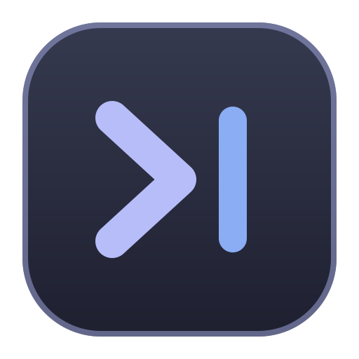
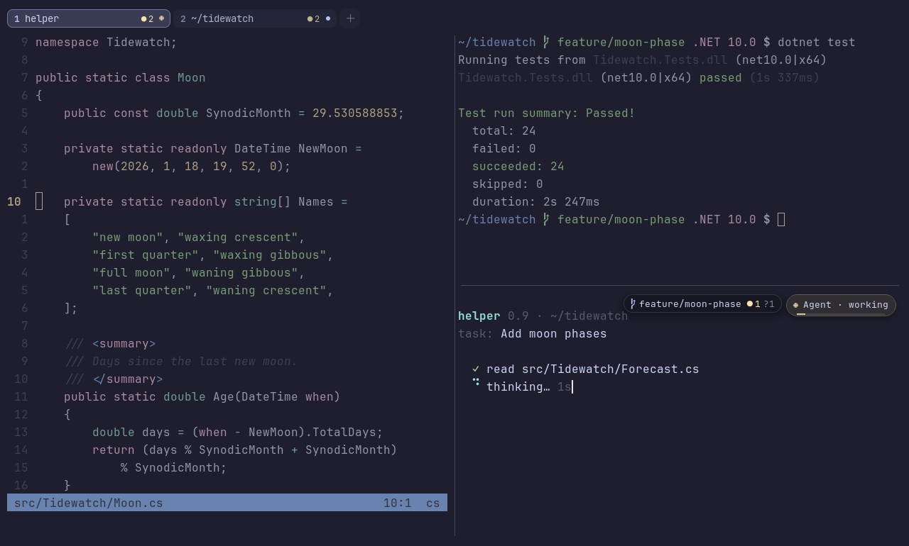
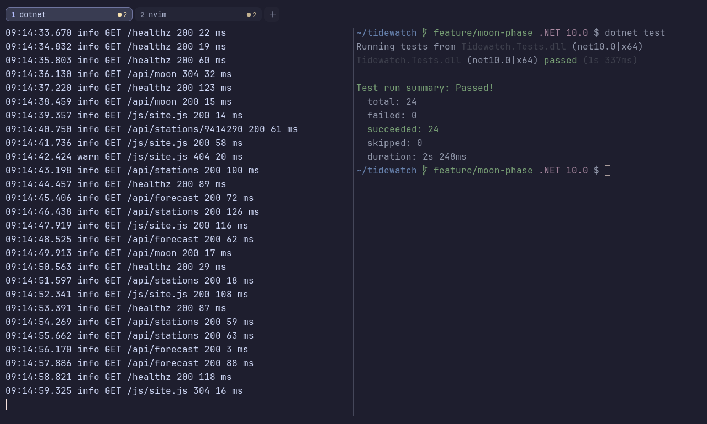
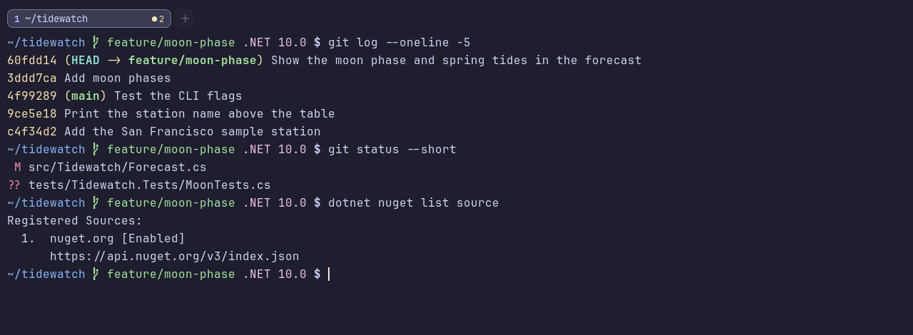
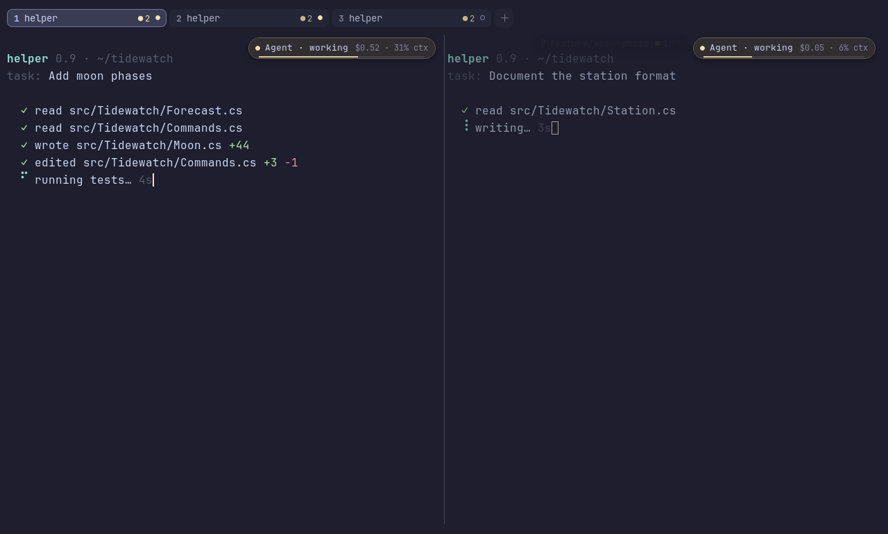
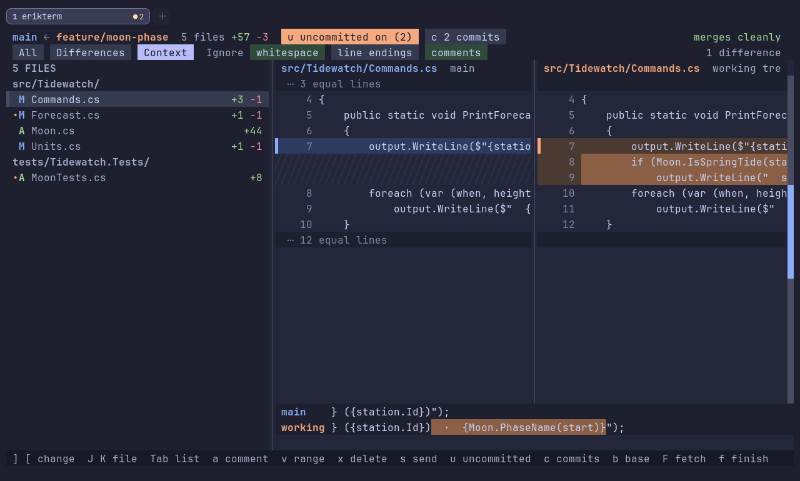
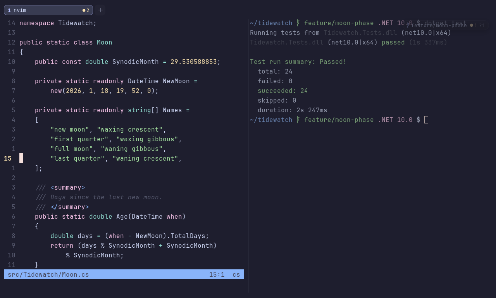
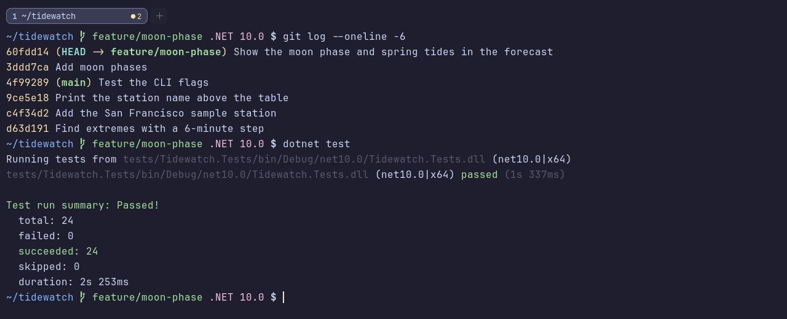
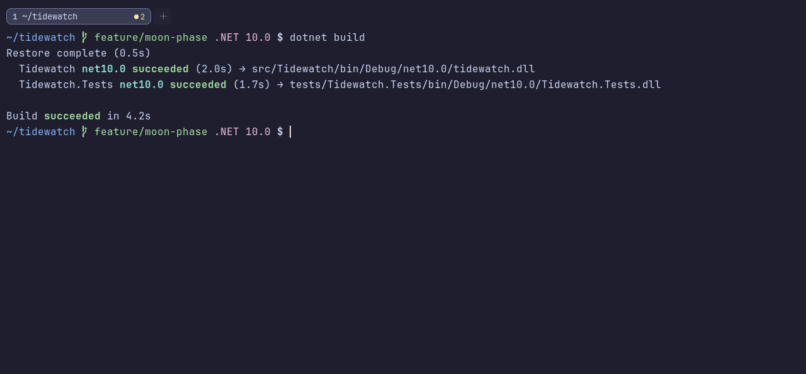

<p align="center">
  
</p>

<h1 align="center">erikterm</h1>

<p align="center">
  <strong>A fast, native terminal built in C# for me, Erik</strong><br>
  GPU-rendered, one small binary, and aware of the tools you run in it.
</p>

<p align="center">
  <a href="https://github.com/eriklieben/erikterm/actions/workflows/build.yml"></a>
  <a href="https://github.com/eriklieben/erikterm/releases"></a>
  <a href="LICENSE"></a>
  
  
  <a href="https://github.com/semantic-release/semantic-release"></a>
</p>

<p align="center">
  <a href="https://sonarcloud.io/summary/new_code?id=eriklieben_erikterm"></a>
  <a href="https://sonarcloud.io/summary/new_code?id=eriklieben_erikterm"></a>
  <a href="https://sonarcloud.io/summary/new_code?id=eriklieben_erikterm"></a>
  <a href="https://sonarcloud.io/summary/new_code?id=eriklieben_erikterm"></a>
  <a href="https://sonarcloud.io/summary/new_code?id=eriklieben_erikterm"></a>
  <a href="https://github.com/eriklieben/erikterm/actions/workflows/codeql.yml"></a>
  <a href="https://scorecard.dev/viewer/?uri=github.com/eriklieben/erikterm"></a>
</p>

<p align="center">
  
</p>

erikterm is a terminal emulator for Linux, Windows and macOS. It is compiled with Native AOT into a single binary of
about 12 MB, starts in tens of milliseconds, and draws nothing while it's idle. Beyond tabs and splits, it understands
what runs inside it: git and GitHub, Neovim, and coding agents such as Claude Code and Codex.

## Features

### Find anything in your history

Search the scrollback with `Ctrl+Shift+F`, or every pane in every tab and window at once with `Ctrl+Shift+S`, then
jump straight to the match.



### Copy without the mouse

Quick select (`Ctrl+Shift+Space`) puts a label on every URL, path, commit hash and number on screen. Type the label to
copy it, or hold Shift to paste it straight into the prompt.



### Keep an eye on your coding agents

erikterm sees which agents are working, finished, or waiting for you, in every tab. `Ctrl+Shift+A` lists them with
the ones that need you first, and `Enter` takes you there. It can also start an agent in a fresh git worktree and
resume your agents after a restart.



### Review a branch before you merge

`erikterm review` shows a branch's changes side by side, with noise such as whitespace dimmed, and tells you whether
it merges cleanly. Conflicts get a merge view of their own.



### Every action, one keystroke away

The command palette (`Ctrl+Shift+P`) searches every action. Browsing themes previews each one live on your own
screen, and `Esc` puts everything back.



### Vim keys for the scrollback

`Ctrl+Shift+X` lets you move, jump between prompts, select and yank through the scrollback with the vim keys you
already know.



### Images in the terminal

Programs can show images inline with the kitty graphics protocol, iTerm2 images or sixel.



### And more

- **Tabs, splits and windows:** drag a tab into its own window and back with its programs still running, zoom a pane,
  pick panes by letter, broadcast input, and restore your session after a restart.
- **Shell integration:** jump between prompts, see which commands failed, and click file paths to open them in Neovim
  at the right line.
- **Developer tools:** the git branch and status of every pane, and GitHub pull request and CI status, right in the
  tab bar. `erikterm devcontainer` opens a shell in a dev container (docker or podman), and splits follow it there.
- **Rendering:** HarfBuzz shaping with ligatures, colour emoji, and box drawing that fills the cell at any line height.
- **Modern protocols:** the kitty keyboard protocol, synchronised output, OSC 8 links, OSC 52 clipboard, styled
  underlines and desktop notifications.
- **Scriptable:** `erikterm cli` controls panes, tabs and windows, and a built-in tmux emulation lets Claude Code's
  agent teams open their panes in erikterm.

## Install

### Arch Linux

Add the repository to the end of `/etc/pacman.conf`:

```ini
[eriklieben]
SigLevel = Optional TrustAll
Server = https://github.com/eriklieben/packages/releases/download/arch
```

Then install, and later update with your normal `sudo pacman -Syu`:

```sh
sudo pacman -Sy erikterm
```

The packages aren't GPG-signed yet, which is what `SigLevel = Optional TrustAll` allows. See
[eriklieben/packages](https://github.com/eriklieben/packages) for details.

### Windows

With [Scoop](https://scoop.sh):

```powershell
scoop bucket add eriklieben https://github.com/eriklieben/packages
scoop install eriklieben/erikterm
```

Or download `erikterm-win-x64-setup.exe` from the [latest release](https://github.com/eriklieben/packages/releases).
It installs into your user profile and needs no administrator rights. It isn't code-signed yet, so Windows may warn
before it runs.

### macOS

Install the libraries with `brew install sdl3 freetype harfbuzz`, then [build from source](#build-from-source).
Apple silicon is built and tested in CI.

## Build from source

You need the [.NET 10 SDK](https://dotnet.microsoft.com/download), and SDL3, FreeType and HarfBuzz from your system's
package manager (`fontconfig` is used for font lookup on Linux).

```sh
git clone https://github.com/eriklieben/erikterm
cd erikterm
scripts/run.sh                                 # publish with Native AOT and start it
dotnet test --project tests/ErikTerm.Tests     # run the tests
```

The shipped binary uses no NuGet packages: SDL3, FreeType and HarfBuzz are loaded from the system.

## Getting started

| Keys | Action |
|---|---|
| `Ctrl+Shift+P` | Command palette: every action, searchable |
| `Ctrl+Shift+T` | New tab |
| `Ctrl+Shift+\` / `Ctrl+Shift+-` | Split right / down |
| `Ctrl+Shift+←↑→↓` | Move between panes |
| `Ctrl+Shift+F` | Search the scrollback |
| `Ctrl+Shift+S` | Search every pane |
| `Ctrl+Shift+Space` | Quick select: copy a URL, path or hash by its label |
| `Ctrl+Shift+X` | Vim mode for the scrollback |
| `Ctrl+Shift+A` | Coding agents, waiting ones first |

On macOS, Cmd takes the place of Ctrl+Shift. The [guide](docs/guide/keys.md) lists every key.

Settings live in `~/.config/erikterm/erikterm.toml` and apply as soon as you save. Setting names follow wezterm's,
and [`erikterm.example.toml`](erikterm.example.toml) lists every option.

## Documentation

- [User guide](docs/README.md): keys, panes and tabs, sessions, shell integration, developer tools, coding agents,
  configuration and scripting.
- [FAQ](docs/faq.md): ssh and TERM, how erikterm compares, where settings live, and privacy: erikterm sends no
  telemetry.
- [Developing erikterm](docs/development/README.md): architecture, building and debugging.
- [Testing and benchmarking](bench/README.md): the test suite, benchmarks and the Windows and macOS test plan.
- [Contributing](CONTRIBUTING.md) and [reporting a security problem](SECURITY.md).

## License

erikterm is released under the [MIT License](LICENSE). Third-party components and their licenses are listed in
[THIRD-PARTY-NOTICES.md](THIRD-PARTY-NOTICES.md).
