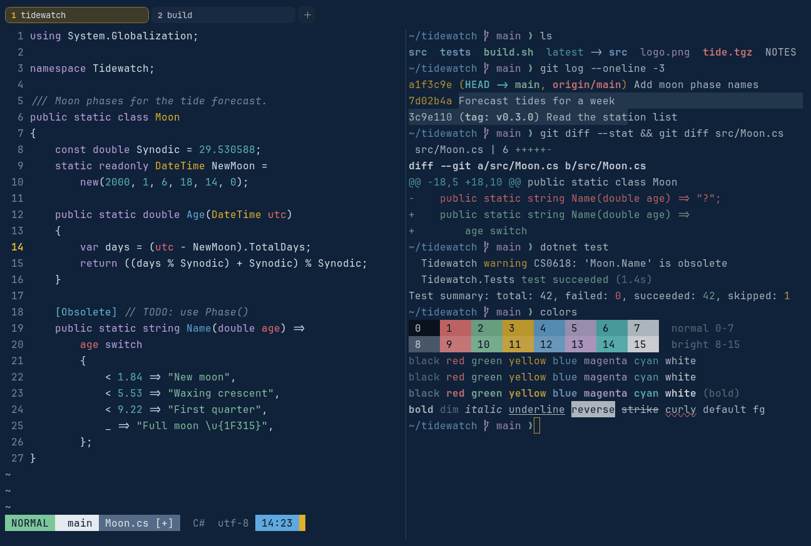

# Abyss & Brass

Dark. Original for erikterm.



## What it looks like

Pale blue-white text on deep-sea navy (#10213a). The accents are coral red, sea green, brass yellow, blue, lilac and
teal. Nautical, with brass highlights.

## Where it comes from

Made for erikterm, inspired by deep-navy keycap sets with brass-yellow accents. Seed colors were chosen by eye, then
adjusted to the contrast floors.

## Use it

```toml
color_scheme = "Abyss & Brass"
```

Its accent, which colors the active tab, focus marks and palette highlights, is `#ebb723` (brass yellow). `[colors]
accent` in your config overrides it.

## Accessibility

Measured from the pixels of the screenshot above (focused editor) and of the same scene with the editor in the
inactive pane (dimmed by the default `inactive_pane_hsb`): the statusline's text against its own block.

| Statusline block | Focused | Dimmed | Without the contrast default |
|---|---|---|---|
| NORMAL (black on green) | 9.22:1 | 6.19:1 | 9.22:1 / 6.19:1 |
| main (black on white) | 15.21:1 | 9.88:1 | 15.21:1 / 9.88:1 |
| Moon.cs [+] (white on bright black) | 4.62:1 | 3.89:1 | 4.62:1 / 3.89:1 |
| C# utf-8 (bright black text) | 4.54:1 | 3.17:1 | 2.88:1 / 2.16:1 |
| 14:23 (black on blue) | 7.12:1 | 5.14:1 | 7.12:1 / 5.14:1 |

Lowest: 4.54:1 focused (target 4.5:1, WCAG AA) and 3.17:1 dimmed (target 3:1). Body text: 12:1.

The palette itself is made for these targets: black text on every color and white text on bright black reach 4.6:1 or
more without any help, and the other colors read at 3:1 or better as text. Bright black is 2.9:1 as text: it is kept
dark enough to carry white text as a block, and the built-in contrast default (`minimum_contrast = 4.5`) lifts it to
4.5:1 where it is text (the C# utf-8 row), like any color used as text below 4.5:1.

## See also

- [Coral Navy](coral-navy.md)
- [Night Owl](night-owl.md)
- [Solarized Dark](solarized-dark.md)
- [All color schemes](README.md)
