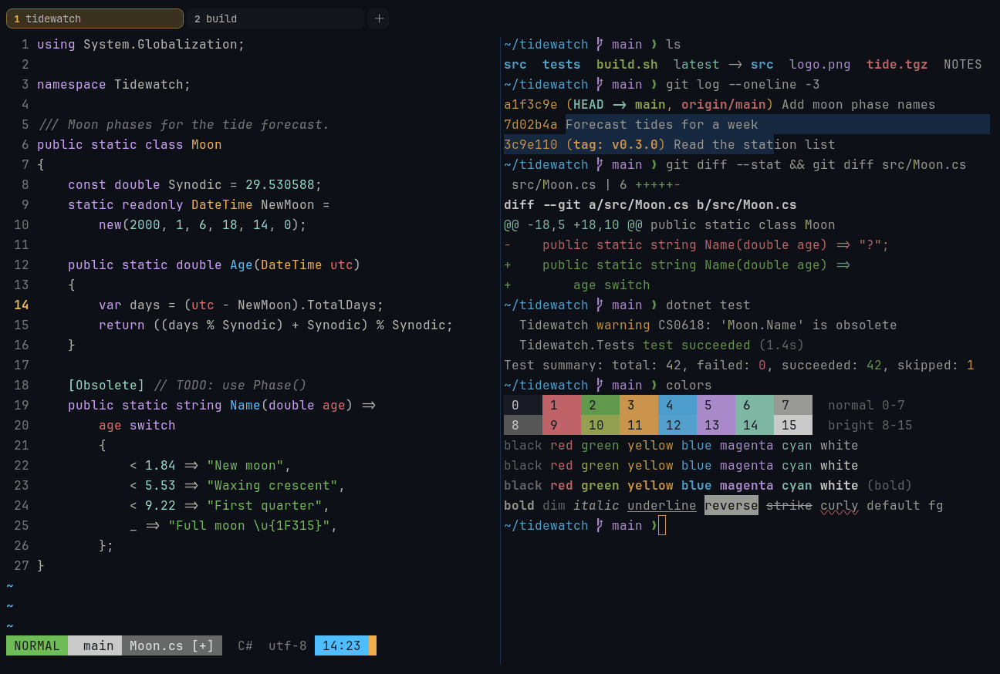

# Ayu Dark

Dark. Upstream: Ayu.



## What it looks like

Warm grey text on near-black (#0d1017). The accents are bright: coral red, green, orange-gold, sky blue, lilac and
mint. Simple and bright.

## Where it comes from

From [ayu](https://github.com/ayu-theme/vscode-ayu) by Ike Ku and the ayu-theme contributors. MIT license.

## Use it

```toml
color_scheme = "Ayu Dark"
```

Its accent, which colors the active tab, focus marks and palette highlights, is `#e6b450` (gold). `[colors] accent` in
your config overrides it.

## Accessibility

Measured from the pixels of the screenshot above (focused editor) and of the same scene with the editor in the
inactive pane (dimmed by the default `inactive_pane_hsb`): the statusline's text against its own block.

| Statusline block | Focused | Dimmed | Without the contrast default |
|---|---|---|---|
| NORMAL (black on green) | 7.36:1 | 5.16:1 | 7.36:1 / 5.16:1 |
| main (black on white) | 9.86:1 | 6.64:1 | 9.86:1 / 6.64:1 |
| Moon.cs [+] (white on bright black) | 4.51:1 | 3.92:1 | 3.3:1 / 2.91:1 |
| C# utf-8 (bright black text) | 4.56:1 | 3.17:1 | 3.41:1 / 2.47:1 |
| 14:23 (black on blue) | 8.03:1 | 5.88:1 | 8.03:1 / 5.88:1 |

Lowest: 4.51:1 focused (target 4.5:1, WCAG AA) and 3.17:1 dimmed (target 3:1). Body text: 10:1.

The built-in contrast default (`minimum_contrast = 4.5`) does the work here. As published, these are below 4.5:1, and
erikterm draws them lighter or darker, keeping their hue, until they reach it: text in black (1.2:1), bright black
(3.4:1); white text on bright black (3.3:1). The palette is as published, not adapted. With `minimum_contrast = 1` in
your config you get the published colors as they are; the notes below describe those.

## See also

- [Ayu Light](ayu-light.md)
- [GitHub Dark](github-dark.md)
- [Carbonfox](carbonfox.md)
- [All color schemes](README.md)
