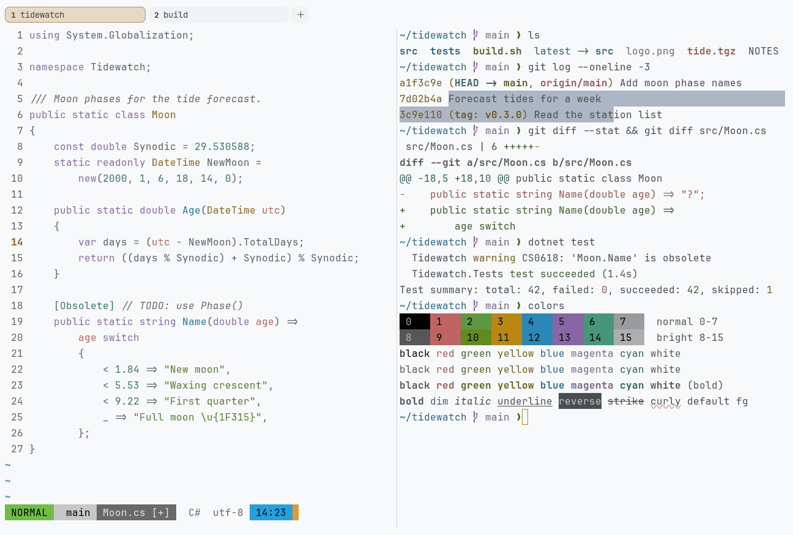

# Ayu Light

Light. Upstream: Ayu.



## What it looks like

Grey text on near-white (#f8f9fa). The accents are bright pastels: coral, green, amber, sky blue, lilac and mint, with
an orange accent. Fresh and light.

## Where it comes from

From [ayu](https://github.com/ayu-theme/vscode-ayu) by Ike Ku and the ayu-theme contributors. MIT license.

## Use it

```toml
color_scheme = "Ayu Light"
```

Its accent, which colors the active tab, focus marks and palette highlights, is `#c57b14` (orange). `[colors] accent`
in your config overrides it.

## Accessibility

Measured from the pixels of the screenshot above (focused editor) and of the same scene with the editor in the
inactive pane (dimmed by the default `inactive_pane_hsb`): the statusline's text against its own block.

| Statusline block | Focused | Dimmed | Without the contrast default |
|---|---|---|---|
| NORMAL (black on green) | 9.17:1 | 6.1:1 | 9.17:1 / 6.1:1 |
| main (black on white) | 12.42:1 | 7.93:1 | 12.42:1 / 7.93:1 |
| Moon.cs [+] (white on bright black) | 4.51:1 | 3.92:1 | 3.3:1 / 2.91:1 |
| C# utf-8 (bright black text) | 5.37:1 | 7.41:1 | 5.37:1 / 7.41:1 |
| 14:23 (black on blue) | 7.26:1 | 5.18:1 | 7.26:1 / 5.18:1 |

Lowest: 4.51:1 focused (target 4.5:1, WCAG AA) and 3.92:1 dimmed (target 3:1). Body text: 6:1.

The built-in contrast default (`minimum_contrast = 4.5`) does the work here. As published, these are below 4.5:1, and
erikterm draws them lighter or darker, keeping their hue, until they reach it: text in red (2.8:1), green (2.2:1),
yellow (2.1:1), blue (2.7:1), magenta (3.3:1), cyan (2.2:1), white (1.6:1), bright red (2.7:1), bright green (2.4:1),
bright yellow (2:1), bright blue (2.6:1), bright magenta (3.2:1), bright cyan (2.2:1), bright white (1.4:1); white
text on bright black (3.3:1); bright white text on bright black (3.6:1). The palette is as published, not adapted.
With `minimum_contrast = 1` in your config you get the published colors as they are; the notes below describe those.

The upstream terminal colors are pastel: most of them are too light to read well as text on white.

## See also

- [Ayu Dark](ayu-dark.md)
- [GitHub Light](github-light.md)
- [One Half Light](one-half-light.md)
- [All color schemes](README.md)
