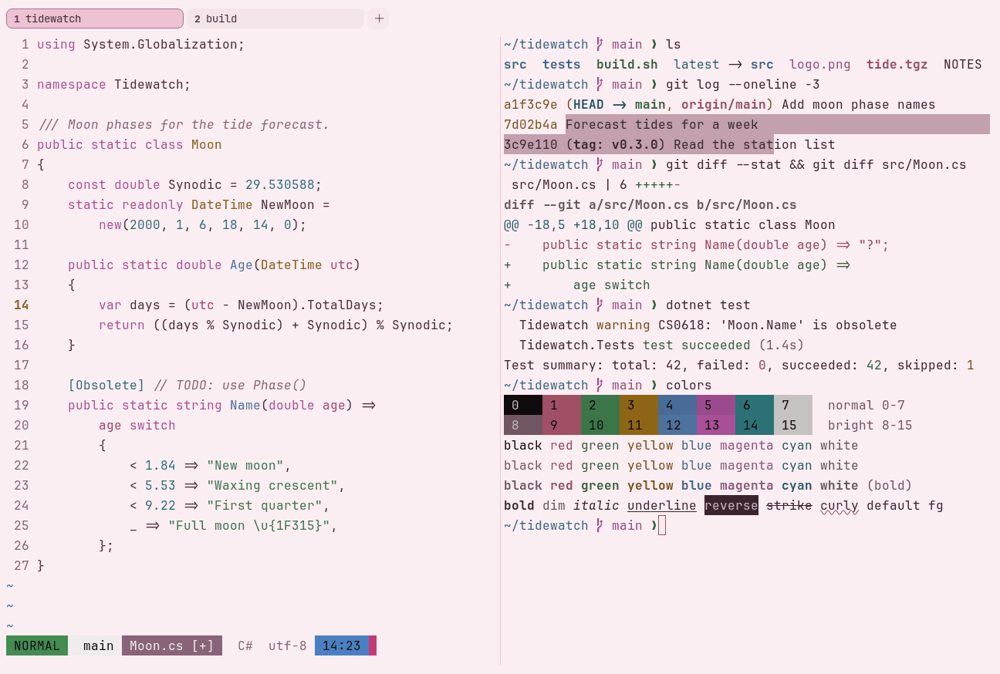

# Blossom

Light. Original for erikterm.



## What it looks like

Plum text on cherry-blossom pink paper (#fbeef2). The accents are deep and clear: rose red, green, ochre, blue, orchid
and teal. A light pink scheme that is meant to be read.

## Where it comes from

Made for erikterm: a light pink scheme, because none with a clear license turned up. Seed colors were chosen by eye,
then adjusted to the contrast floors.

## Use it

```toml
color_scheme = "Blossom"
```

Its accent, which colors the active tab, focus marks and palette highlights, is `#d6337a` (pink). `[colors] accent` in
your config overrides it.

## Accessibility

Measured from the pixels of the screenshot above (focused editor) and of the same scene with the editor in the
inactive pane (dimmed by the default `inactive_pane_hsb`): the statusline's text against its own block.

| Statusline block | Focused | Dimmed | Without the contrast default |
|---|---|---|---|
| NORMAL (black on green) | 4.75:1 | 3.4:1 | 4.75:1 / 3.4:1 |
| main (black on white) | 17.17:1 | 10.95:1 | 17.17:1 / 10.95:1 |
| Moon.cs [+] (white on bright black) | 4.62:1 | 3.89:1 | 4.62:1 / 3.89:1 |
| C# utf-8 (bright black text) | 4.68:1 | 6.28:1 | 4.68:1 / 6.28:1 |
| 14:23 (black on blue) | 4.74:1 | 3.63:1 | 4.74:1 / 3.63:1 |

Lowest: 4.62:1 focused (target 4.5:1, WCAG AA) and 3.4:1 dimmed (target 3:1). Body text: 11:1.

The palette itself is made for these targets: black text on every color and white text on bright black reach 4.6:1 or
more without any help, and bright black text reaches it too. Every color reads at 3:1 or better as text; the built-in
contrast default (`minimum_contrast = 4.5`) lifts the ones below 4.5:1 to 4.5:1.

## See also

- [Cream & Rose](cream-and-rose.md)
- [Lumina Oxblood Light](lumina-oxblood-light.md)
- [Night Blossom](night-blossom.md)
- [All color schemes](README.md)
