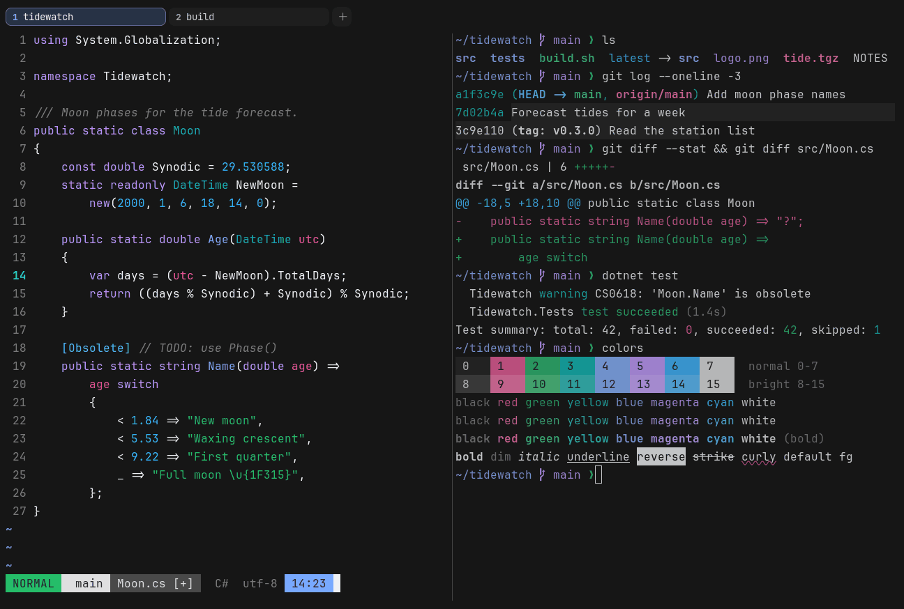

# Carbonfox

Dark. Upstream: Nightfox.



## What it looks like

Bright white text on neutral near-black (#161616). The accents come from IBM's Carbon colors: pink, green, teal, blue,
purple and sky blue. Sharp and high in contrast.

## Where it comes from

From [nightfox.nvim](https://github.com/EdenEast/nightfox.nvim) by EdenEast, which credits oxocarbon.nvim (IBM Carbon colors) for it. MIT
license.

## Use it

```toml
color_scheme = "Carbonfox"
```

Its accent, which colors the active tab, focus marks and palette highlights, is `#78a9ff` (blue). `[colors] accent` in
your config overrides it.

## Accessibility

Measured from the pixels of the screenshot above (focused editor) and of the same scene with the editor in the
inactive pane (dimmed by the default `inactive_pane_hsb`): the statusline's text against its own block.

| Statusline block | Focused | Dimmed | Without the contrast default |
|---|---|---|---|
| NORMAL (black on green) | 6.15:1 | 4.51:1 | 6.15:1 / 4.51:1 |
| main (black on white) | 11.22:1 | 7.78:1 | 11.22:1 / 7.78:1 |
| Moon.cs [+] (white on bright black) | 6.87:1 | 5.37:1 | 6.87:1 / 5.37:1 |
| C# utf-8 (bright black text) | 4.52:1 | 3.15:1 | 1.98:1 / 1.59:1 |
| 14:23 (black on blue) | 6.27:1 | 4.95:1 | 6.27:1 / 4.95:1 |

Lowest: 4.52:1 focused (target 4.5:1, WCAG AA) and 3.15:1 dimmed (target 3:1). Body text: 16:1.

The built-in contrast default (`minimum_contrast = 4.5`) does the work here. As published, these are below 4.5:1, and
erikterm draws them lighter or darker, keeping their hue, until they reach it: text in black (1.2:1), bright black
(2:1). The palette is as published, not adapted. With `minimum_contrast = 1` in your config you get the published
colors as they are; the notes below describe those.

Upstream ANSI yellow is a teal, not a yellow. Bright black is a dark grey, so autosuggestions and comments are faint.

## See also

- [Nightfox](nightfox.md)
- [GitHub Dark](github-dark.md)
- [Ayu Dark](ayu-dark.md)
- [All color schemes](README.md)
