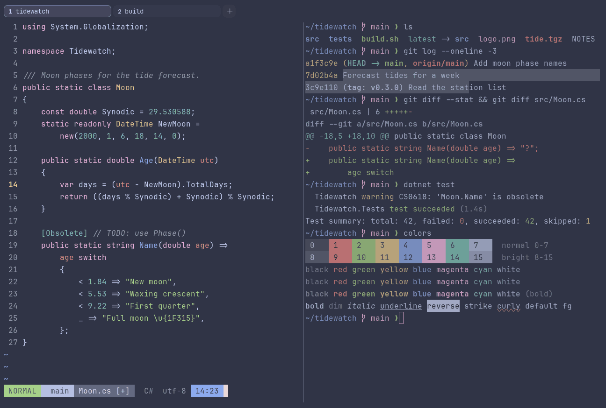

# Catppuccin Frappé

Dark. Upstream: Catppuccin.



## What it looks like

Pale blue text on a slate background (#303446). The accents are Catppuccin's pastels: rose red, green, cream yellow,
blue, pink and teal. The lightest of the dark flavors.

## Where it comes from

From [Catppuccin](https://github.com/catppuccin/wezterm), a community pastel theme made for many apps. MIT license.

## Use it

```toml
color_scheme = "Catppuccin Frappé"
```

Its accent, which colors the active tab, focus marks and palette highlights, is `#babbf1` (lavender). `[colors]
accent` in your config overrides it.

## Accessibility

Measured from the pixels of the screenshot above (focused editor) and of the same scene with the editor in the
inactive pane (dimmed by the default `inactive_pane_hsb`): the statusline's text against its own block.

| Statusline block | Focused | Dimmed | Without the contrast default |
|---|---|---|---|
| NORMAL (black on green) | 4.59:1 | 3.76:1 | 4.19:1 / 3.49:1 |
| main (black on white) | 4.59:1 | 3.83:1 | 3.99:1 / 3.43:1 |
| Moon.cs [+] (white on bright black) | 4.5:1 | 3.85:1 | 3.02:1 / 2.7:1 |
| C# utf-8 (bright black text) | 4.5:1 | 3.04:1 | 2.23:1 / 1.67:1 |
| 14:23 (black on blue) | 4.52:1 | 3.76:1 | 3.1:1 / 2.8:1 |

Lowest: 4.5:1 focused (target 4.5:1, WCAG AA) and 3.04:1 dimmed (target 3:1). Body text: 8.1:1.

The built-in contrast default (`minimum_contrast = 4.5`) does the work here. As published, these are below 4.5:1, and
erikterm draws them lighter or darker, keeping their hue, until they reach it: text in black (1.7:1), bright black
(2.2:1); black text on green (4.1:1), white (3.9:1), blue (3.1:1); white text on bright black (3:1); bright white text
on bright black (2.5:1). The palette is as published, not adapted. With `minimum_contrast = 1` in your config you get
the published colors as they are; the notes below describe those.

Bright black (autosuggestions, comments) sits close to the background.

## See also

- [Catppuccin Macchiato](catppuccin-macchiato.md)
- [Catppuccin Mocha](catppuccin-mocha.md)
- [Catppuccin Latte](catppuccin-latte.md)
- [All color schemes](README.md)
