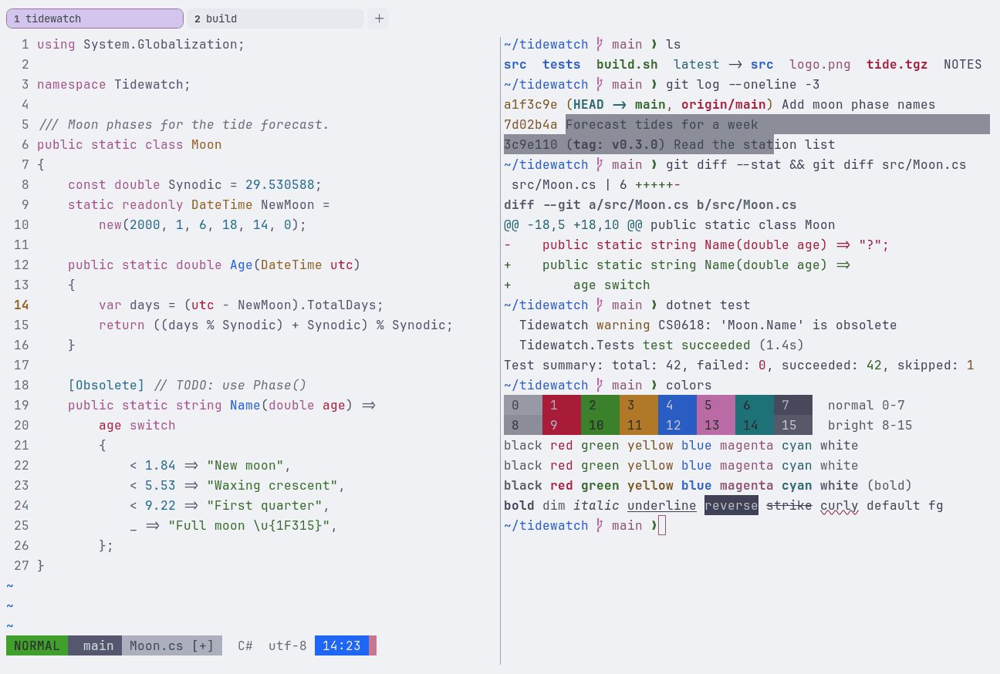

# Catppuccin Latte

Light. Upstream: Catppuccin.



## What it looks like

Dark slate text on a cool off-white (#eff1f5). The accents are Catppuccin's: red, green, peach yellow, blue, pink and
teal. The only light flavour of Catppuccin.

## Where it comes from

From [Catppuccin](https://github.com/catppuccin/wezterm), a community pastel theme made for many apps. MIT license.

## Use it

```toml
color_scheme = "Catppuccin Latte"
```

Its accent, which colors the active tab, focus marks and palette highlights, is `#8839ef` (mauve). `[colors]
accent` in your config overrides it.

## Accessibility

Measured from the pixels of the screenshot above (focused editor) and of the same scene with the editor in the
inactive pane (dimmed by the default `inactive_pane_hsb`): the statusline's text against its own block.

| Statusline block | Focused | Dimmed | Without the contrast default |
|---|---|---|---|
| NORMAL (black on green) | 4.57:1 | 3.42:1 | 1.84:1 / 1.75:1 |
| main (black on white) | 4.51:1 | 3.77:1 | 3.44:1 / 2.95:1 |
| Moon.cs [+] (white on bright black) | 4.57:1 | 3.65:1 | 2.94:1 / 2.55:1 |
| C# utf-8 (bright black text) | 4.57:1 | 6.29:1 | 1.93:1 / 2.93:1 |
| 14:23 (black on blue) | 4.5:1 | 3.48:1 | 2.7:1 / 2.18:1 |

Lowest: 4.5:1 focused (target 4.5:1, WCAG AA) and 3.42:1 dimmed (target 3:1). Body text: 7.1:1.

The built-in contrast default (`minimum_contrast = 4.5`) does the work here. As published, these are below 4.5:1, and
erikterm draws them lighter or darker, keeping their hue, until they reach it: text in black (1.6:1), green (3:1),
yellow (2.3:1), blue (4.3:1), magenta (2.3:1), cyan (3.3:1), bright black (1.9:1), bright green (3:1), bright yellow
(2.3:1), bright blue (4.3:1), bright magenta (2.3:1), bright cyan (3.3:1), bright white (4.4:1); black text on green
(1.8:1), white (3.4:1), blue (2.7:1); white text on bright black (2.9:1); bright white text on bright black (2.3:1).
The palette is as published, not adapted. With `minimum_contrast = 1` in your config you get the published colors as
they are; the notes below describe those.

Upstream green, yellow and pink are light for a light background.

## See also

- [Catppuccin Frappé](catppuccin-frappe.md)
- [Catppuccin Macchiato](catppuccin-macchiato.md)
- [Catppuccin Mocha](catppuccin-mocha.md)
- [All color schemes](README.md)
