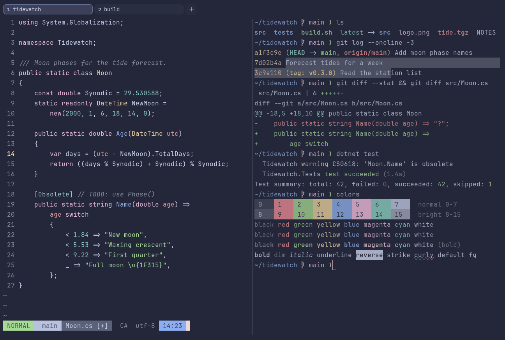

# Catppuccin Macchiato

Dark. Upstream: Catppuccin.



## What it looks like

Pale blue-white text on a slate-blue background (#24273a). The accents are Catppuccin's pastels: rose red, green,
peach yellow, blue, pink and teal. Softer and a little lighter than Mocha.

## Where it comes from

From [Catppuccin](https://github.com/catppuccin/catppuccin), a community pastel theme made for many apps. MIT license.

## Use it

```toml
color_scheme = "Catppuccin Macchiato"
```

Its accent, which colors the active tab, focus marks and palette highlights, is `#b7bdf8` (lavender). `[colors]
accent` in your config overrides it.

## Accessibility

Measured from the pixels of the screenshot above (focused editor) and of the same scene with the editor in the
inactive pane (dimmed by the default `inactive_pane_hsb`): the statusline's text against its own block.

| Statusline block | Focused | Dimmed | Without the contrast default |
|---|---|---|---|
| NORMAL (black on green) | 5.26:1 | 4.22:1 | 5.26:1 / 4.22:1 |
| main (black on white) | 4.68:1 | 3.86:1 | 4.68:1 / 3.86:1 |
| Moon.cs [+] (white on bright black) | 4.5:1 | 3.8:1 | 3.44:1 / 2.98:1 |
| C# utf-8 (bright black text) | 4.52:1 | 3.12:1 | 2.38:1 / 1.81:1 |
| 14:23 (black on blue) | 4.55:1 | 3.8:1 | 3.7:1 / 3.25:1 |

Lowest: 4.5:1 focused (target 4.5:1, WCAG AA) and 3.12:1 dimmed (target 3:1). Body text: 9.9:1.

The built-in contrast default (`minimum_contrast = 4.5`) does the work here. As published, these are below 4.5:1, and
erikterm draws them lighter or darker, keeping their hue, until they reach it: text in black (1.8:1), bright black
(2.4:1); black text on blue (3.7:1); white text on bright black (3.4:1); bright white text on bright black (2.8:1).
The palette is as published, not adapted. With `minimum_contrast = 1` in your config you get the published colors as
they are; the notes below describe those.

Bright black is a muted slate and the weakest color in the palette.

## See also

- [Catppuccin Mocha](catppuccin-mocha.md)
- [Catppuccin Frappé](catppuccin-frappe.md)
- [Catppuccin Latte](catppuccin-latte.md)
- [All color schemes](README.md)
