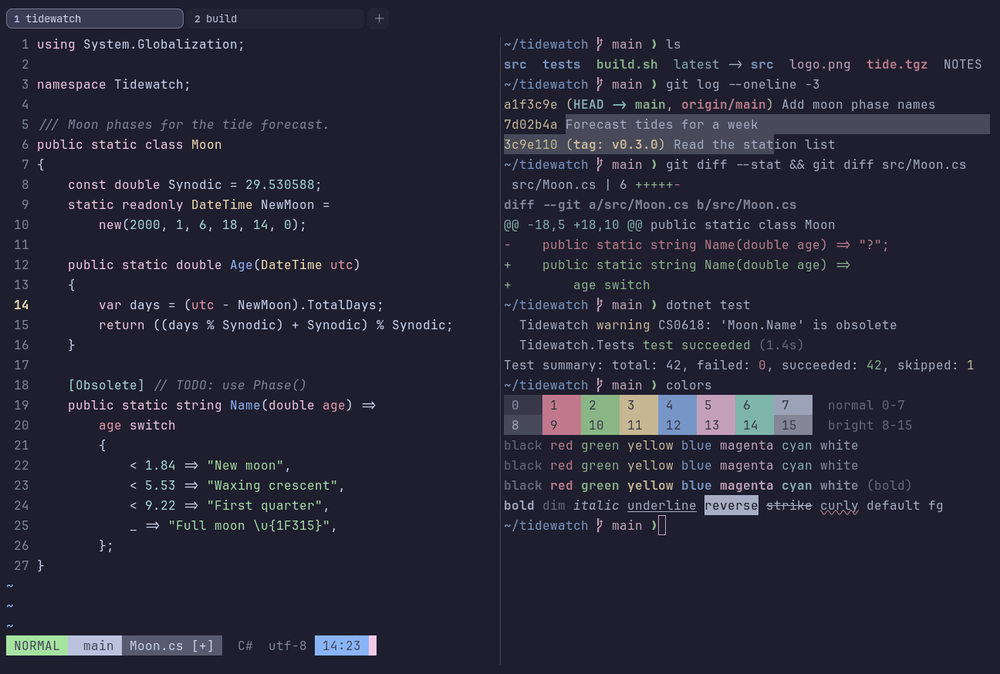

# Catppuccin Mocha

Dark. Upstream: Catppuccin.



## What it looks like

Pale blue-white text on a deep blue-black background (#1e1e2e). The accents are Catppuccin's pastels: pink-red, green,
cream yellow, blue, pink and teal. The darkest of the Catppuccin flavors.

## Where it comes from

From [Catppuccin](https://github.com/catppuccin/catppuccin), a community pastel theme made for many apps. MIT license.

## Use it

```toml
color_scheme = "Catppuccin Mocha"
```

Its accent, which colors the active tab, focus marks and palette highlights, is `#b4befe` (lavender). `[colors]
accent` in your config overrides it.

## Accessibility

Measured from the pixels of the screenshot above (focused editor) and of the same scene with the editor in the
inactive pane (dimmed by the default `inactive_pane_hsb`): the statusline's text against its own block.

| Statusline block | Focused | Dimmed | Without the contrast default |
|---|---|---|---|
| NORMAL (black on green) | 6.23:1 | 4.94:1 | 6.23:1 / 4.94:1 |
| main (black on white) | 5.23:1 | 4.23:1 | 5.23:1 / 4.23:1 |
| Moon.cs [+] (white on bright black) | 4.51:1 | 3.82:1 | 3.77:1 / 3.25:1 |
| C# utf-8 (bright black text) | 4.54:1 | 3.14:1 | 2.46:1 / 1.88:1 |
| 14:23 (black on blue) | 4.53:1 | 3.85:1 | 4.33:1 / 3.74:1 |

Lowest: 4.51:1 focused (target 4.5:1, WCAG AA) and 3.14:1 dimmed (target 3:1). Body text: 11:1.

The built-in contrast default (`minimum_contrast = 4.5`) does the work here. As published, these are below 4.5:1, and
erikterm draws them lighter or darker, keeping their hue, until they reach it: text in black (1.8:1), bright black
(2.5:1); black text on blue (4.3:1); white text on bright black (3.8:1); bright white text on bright black (3:1). The
palette is as published, not adapted. With `minimum_contrast = 1` in your config you get the published colors as they
are; the notes below describe those.

Bright black is a muted grey-blue and the weakest color in the palette.

## See also

- [Catppuccin Macchiato](catppuccin-macchiato.md)
- [Catppuccin Frappé](catppuccin-frappe.md)
- [Catppuccin Latte](catppuccin-latte.md)
- [All color schemes](README.md)
