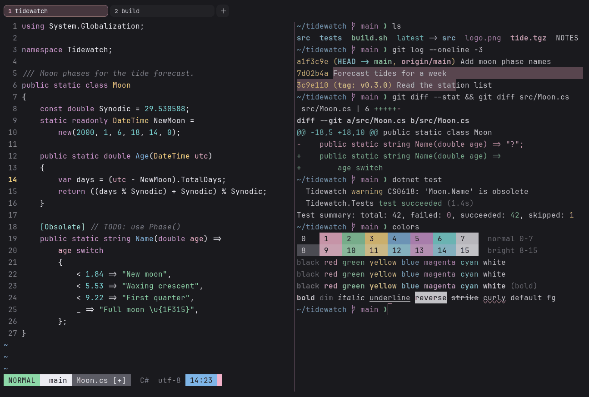

# Cherry Blossom

Dark. Upstream: Cherry Blossom.



## What it looks like

Near-white text on neutral charcoal (#1a1a1e). The accents are pastel: sakura pink, mint, butter yellow, sky blue,
orchid and aqua. Light and spring-like.

## Where it comes from

From [cherry-blossom-vscode-theme](https://github.com/daitsuku/cherry-blossom-vscode-theme) by daitsuku. MIT license.

## Use it

```toml
color_scheme = "Cherry Blossom"
```

Its accent, which colors the active tab, focus marks and palette highlights, is `#f8b2cc` (pink). `[colors] accent` in
your config overrides it.

## Accessibility

Measured from the pixels of the screenshot above (focused editor) and of the same scene with the editor in the
inactive pane (dimmed by the default `inactive_pane_hsb`): the statusline's text against its own block.

| Statusline block | Focused | Dimmed | Without the contrast default |
|---|---|---|---|
| NORMAL (black on green) | 10.22:1 | 7.01:1 | 10.22:1 / 7.01:1 |
| main (black on white) | 13.92:1 | 9.25:1 | 13.92:1 / 9.25:1 |
| Moon.cs [+] (white on bright black) | 5.42:1 | 4.54:1 | 5.42:1 / 4.54:1 |
| C# utf-8 (bright black text) | 4.55:1 | 3.18:1 | 2.63:1 / 1.98:1 |
| 14:23 (black on blue) | 7.73:1 | 5.62:1 | 7.73:1 / 5.62:1 |

Lowest: 4.55:1 focused (target 4.5:1, WCAG AA) and 3.18:1 dimmed (target 3:1). Body text: 16:1.

The built-in contrast default (`minimum_contrast = 4.5`) does the work here. As published, these are below 4.5:1, and
erikterm draws them lighter or darker, keeping their hue, until they reach it: text in black (1:1), bright black
(2.6:1). The palette is as published, not adapted. With `minimum_contrast = 1` in your config you get the published
colors as they are; the notes below describe those.

Red is a soft pink here, so errors and diff deletions stand out less than in most schemes.

## See also

- [Night Blossom](night-blossom.md)
- [Shado](shado.md)
- [Blossom](blossom.md)
- [All color schemes](README.md)
