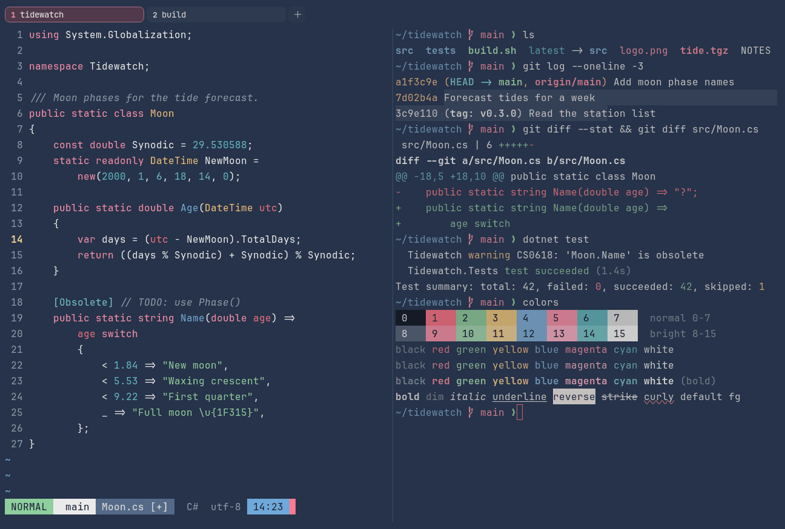

# Coral Navy

Dark. Original for erikterm.



## What it looks like

Warm white text on slate navy (#26334a). The accents are coral red, mint, sand, blue, pink and sea teal. Bright and
friendly on a calm background.

## Where it comes from

Made for erikterm, inspired by navy keycap sets with coral pink and teal. Seed colors were chosen by eye, then
adjusted to the contrast floors.

## Use it

```toml
color_scheme = "Coral Navy"
```

Its accent, which colors the active tab, focus marks and palette highlights, is `#ff7a90` (coral). `[colors] accent`
in your config overrides it.

## Accessibility

Measured from the pixels of the screenshot above (focused editor) and of the same scene with the editor in the
inactive pane (dimmed by the default `inactive_pane_hsb`): the statusline's text against its own block.

| Statusline block | Focused | Dimmed | Without the contrast default |
|---|---|---|---|
| NORMAL (black on green) | 9.26:1 | 6.35:1 | 9.26:1 / 6.35:1 |
| main (black on white) | 13.42:1 | 8.95:1 | 13.42:1 / 8.95:1 |
| Moon.cs [+] (white on bright black) | 4.61:1 | 3.84:1 | 4.61:1 / 3.84:1 |
| C# utf-8 (bright black text) | 4.5:1 | 3.07:1 | 2.24:1 / 1.7:1 |
| 14:23 (black on blue) | 6.47:1 | 4.81:1 | 6.47:1 / 4.81:1 |

Lowest: 4.5:1 focused (target 4.5:1, WCAG AA) and 3.07:1 dimmed (target 3:1). Body text: 11:1.

The palette itself is made for these targets: black text on every color and white text on bright black reach 4.6:1 or
more without any help, and the other colors read at 3:1 or better as text. Bright black is 2.2:1 as text: it is kept
dark enough to carry white text as a block, and the built-in contrast default (`minimum_contrast = 4.5`) lifts it to
4.5:1 where it is text (the C# utf-8 row), like any color used as text below 4.5:1.

## See also

- [Abyss & Brass](abyss-and-brass.md)
- [Graphite & Blush](graphite-and-blush.md)
- [Nord](nord.md)
- [All color schemes](README.md)
