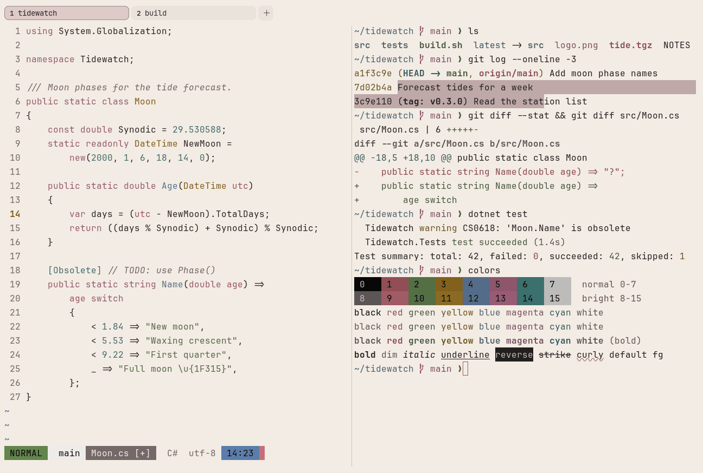

# Cream & Rose

Light. Original for erikterm.



## What it looks like

Near-black text on warm cream (#f3ece4). The accents are muted: brick rose, olive green, ochre, slate blue, mauve and
teal, with a dusty-rose accent. Warm and quiet.

## Where it comes from

Made for erikterm, inspired by keycap sets with cream keys and dusty-rose modifiers. Seed colors were chosen by eye,
then adjusted to the contrast floors.

## Use it

```toml
color_scheme = "Cream & Rose"
```

Its accent, which colors the active tab, focus marks and palette highlights, is `#b0646e` (dusty rose). `[colors]
accent` in your config overrides it.

## Accessibility

Measured from the pixels of the screenshot above (focused editor) and of the same scene with the editor in the
inactive pane (dimmed by the default `inactive_pane_hsb`): the statusline's text against its own block.

| Statusline block | Focused | Dimmed | Without the contrast default |
|---|---|---|---|
| NORMAL (black on green) | 4.76:1 | 3.37:1 | 4.76:1 / 3.37:1 |
| main (black on white) | 17.21:1 | 10.94:1 | 17.21:1 / 10.94:1 |
| Moon.cs [+] (white on bright black) | 4.61:1 | 3.93:1 | 4.61:1 / 3.93:1 |
| C# utf-8 (bright black text) | 4.68:1 | 6.34:1 | 4.68:1 / 6.34:1 |
| 14:23 (black on blue) | 4.77:1 | 3.57:1 | 4.77:1 / 3.57:1 |

Lowest: 4.61:1 focused (target 4.5:1, WCAG AA) and 3.37:1 dimmed (target 3:1). Body text: 13:1.

The palette itself is made for these targets: black text on every color and white text on bright black reach 4.6:1 or
more without any help, and bright black text reaches it too. Every color reads at 3:1 or better as text; the built-in
contrast default (`minimum_contrast = 4.5`) lifts the ones below 4.5:1 to 4.5:1.

## See also

- [Onyx & Rose](onyx-and-rose.md)
- [Blossom](blossom.md)
- [Sage Garden](sage-garden.md)
- [All color schemes](README.md)
