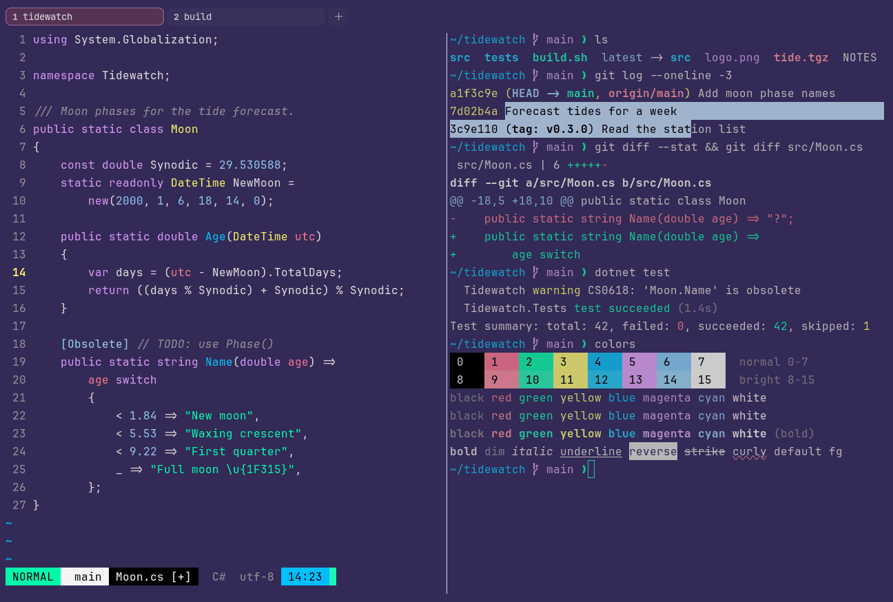

# Cyberpunk

Dark. Upstream: Cyberpunk.



## What it looks like

Light grey text on violet (#332a57). The accents are neon: pink, mint, yellow, sky blue, lilac and pale blue. Bright
and playful.

## Where it comes from

From [cyberpunk-iterm](https://github.com/Murderlon/cyberpunk-iterm) by Merlijn Vos (Murderlon). MIT license (stated
in the project's README).

## Use it

```toml
color_scheme = "Cyberpunk"
```

Its accent, which colors the active tab, focus marks and palette highlights, is `#ff7092` (pink). `[colors] accent` in
your config overrides it.

## Accessibility

Measured from the pixels of the screenshot above (focused editor) and of the same scene with the editor in the
inactive pane (dimmed by the default `inactive_pane_hsb`): the statusline's text against its own block.

| Statusline block | Focused | Dimmed | Without the contrast default |
|---|---|---|---|
| NORMAL (black on green) | 15.39:1 | 9.79:1 | 15.39:1 / 9.79:1 |
| main (black on white) | 21.0:1 | 13.08:1 | 21.0:1 / 13.08:1 |
| Moon.cs [+] (white on bright black) | 21.0:1 | 13.08:1 | 21.0:1 / 13.08:1 |
| C# utf-8 (bright black text) | 4.52:1 | 3.04:1 | 1.61:1 / 1.61:1 |
| 14:23 (black on blue) | 9.9:1 | 6.79:1 | 9.9:1 / 6.79:1 |

Lowest: 4.52:1 focused (target 4.5:1, WCAG AA) and 3.04:1 dimmed (target 3:1). Body text: 10:1.

The built-in contrast default (`minimum_contrast = 4.5`) does the work here. As published, these are below 4.5:1, and
erikterm draws them lighter or darker, keeping their hue, until they reach it: text in black (1.6:1), bright black
(1.6:1). The palette is as published, not adapted. With `minimum_contrast = 1` in your config you get the published
colors as they are; the notes below describe those.

Black and bright black are both pure black, so autosuggestions in bright black are hard to see.

## See also

- [SynthWave '84](synthwave-84.md)
- [Neon Grid](neon-grid.md)
- [Shades of Purple](shades-of-purple.md)
- [All color schemes](README.md)
