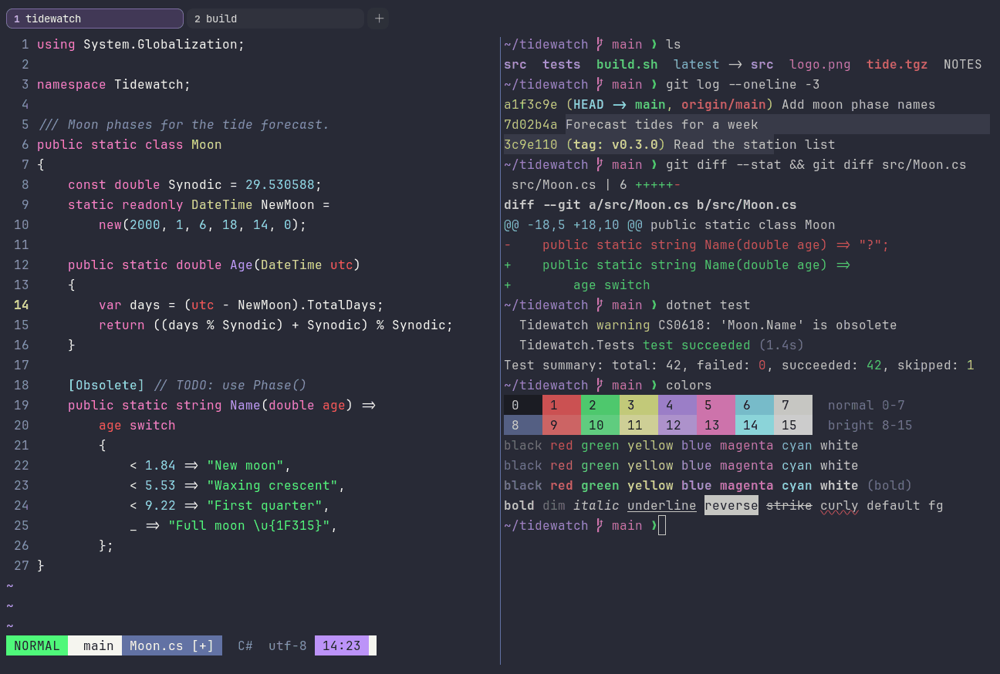

# Dracula

Dark. Upstream: Dracula.



## What it looks like

Off-white text on a blue-grey background (#282a36). The accents are bright and saturated: red, neon green, pale
yellow, purple, pink and cyan. Bold and high-energy, and one of the most widely used themes anywhere.

## Where it comes from

From [Dracula](https://github.com/dracula/wezterm) by Zeno Rocha and the Dracula Theme contributors. MIT license.

## Use it

```toml
color_scheme = "Dracula"
```

Its accent, which colors the active tab, focus marks and palette highlights, is `#bd93f9` (purple). `[colors] accent`
in your config overrides it.

## Accessibility

Measured from the pixels of the screenshot above (focused editor) and of the same scene with the editor in the
inactive pane (dimmed by the default `inactive_pane_hsb`): the statusline's text against its own block.

| Statusline block | Focused | Dimmed | Without the contrast default |
|---|---|---|---|
| NORMAL (black on green) | 11.65:1 | 8.01:1 | 11.65:1 / 8.01:1 |
| main (black on white) | 14.99:1 | 10.02:1 | 14.99:1 / 10.02:1 |
| Moon.cs [+] (white on bright black) | 4.5:1 | 3.75:1 | 4.41:1 / 3.67:1 |
| C# utf-8 (bright black text) | 4.5:1 | 3.16:1 | 3.03:1 / 2.27:1 |
| 14:23 (black on blue) | 6.55:1 | 5.07:1 | 6.55:1 / 5.07:1 |

Lowest: 4.5:1 focused (target 4.5:1, WCAG AA) and 3.16:1 dimmed (target 3:1). Body text: 13:1.

The built-in contrast default (`minimum_contrast = 4.5`) does the work here. As published, these are below 4.5:1, and
erikterm draws them lighter or darker, keeping their hue, until they reach it: text in black (1.1:1), bright black
(3:1); white text on bright black (4.4:1). The palette is as published, not adapted. With `minimum_contrast = 1` in
your config you get the published colors as they are; the notes below describe those.

## See also

- [Shades of Purple](shades-of-purple.md)
- [SynthWave '84](synthwave-84.md)
- [Night Owl](night-owl.md)
- [All color schemes](README.md)
