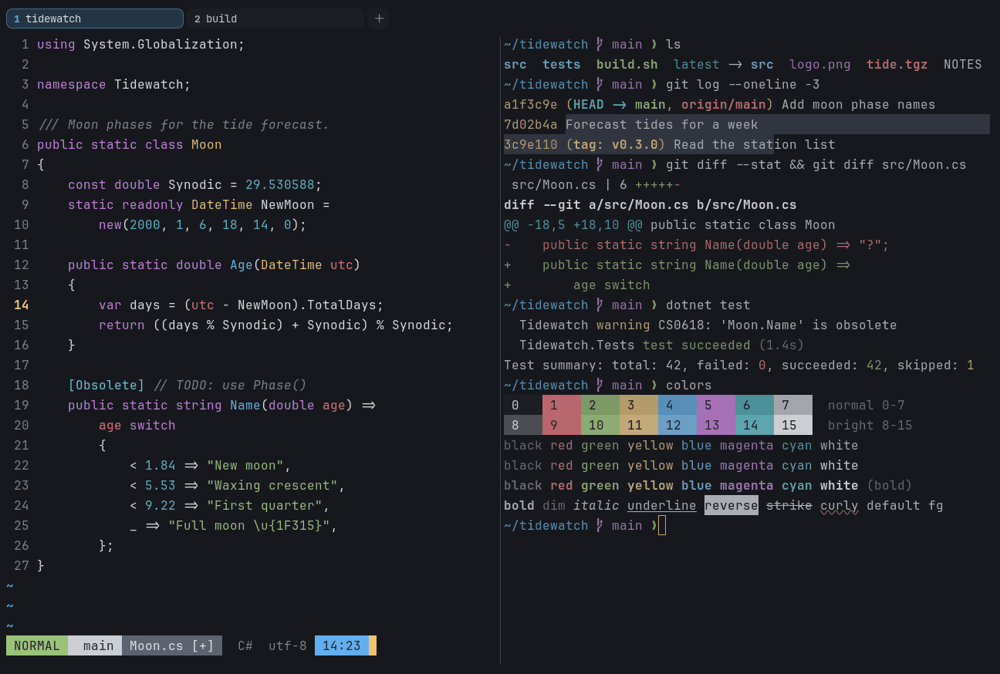

# erik

Dark. Original for erikterm, and its default scheme.



## What it looks like

Light grey text on a near-black, slightly blue background (#16181d). The colors are soft red, green, gold, blue,
violet and teal, with a gold cursor that is easy to find. It is a calm, neutral dark scheme meant for long sessions.

## Where it comes from

erikterm's own default scheme. Its normal colors are the accents of Atom's One Dark, set on a darker background, with
brighter brights and a gold cursor added for erikterm.

## Use it

```toml
color_scheme = "erik"
```

Its accent, which colors the active tab, focus marks and palette highlights, is `#61afef` (blue). `[colors] accent` in
your config overrides it.

## Accessibility

Measured from the pixels of the screenshot above (focused editor) and of the same scene with the editor in the
inactive pane (dimmed by the default `inactive_pane_hsb`): the statusline's text against its own block.

| Statusline block | Focused | Dimmed | Without the contrast default |
|---|---|---|---|
| NORMAL (black on green) | 7.6:1 | 5.41:1 | 7.6:1 / 5.41:1 |
| main (black on white) | 9.52:1 | 6.67:1 | 9.52:1 / 6.67:1 |
| Moon.cs [+] (white on bright black) | 4.52:1 | 3.85:1 | 3.75:1 / 3.24:1 |
| C# utf-8 (bright black text) | 4.53:1 | 3.17:1 | 2.94:1 / 2.19:1 |
| 14:23 (black on blue) | 6.42:1 | 4.9:1 | 6.42:1 / 4.9:1 |

Lowest: 4.52:1 focused (target 4.5:1, WCAG AA) and 3.17:1 dimmed (target 3:1). Body text: 12:1.

The built-in contrast default (`minimum_contrast = 4.5`) does the work here. As published, these are below 4.5:1, and
erikterm draws them lighter or darker, keeping their hue, until they reach it: text in black (1.2:1), bright black
(2.9:1); white text on bright black (3.8:1). The palette is as published, not adapted. With `minimum_contrast = 1` in
your config you get the published colors as they are; the notes below describe those.

Bright black (autosuggestions, comments, dim hints) is a muted grey and is the weakest color here.

## See also

- [One Half Dark](one-half-dark.md)
- [Tokyo Night](tokyo-night.md)
- [Catppuccin Mocha](catppuccin-mocha.md)
- [All color schemes](README.md)
