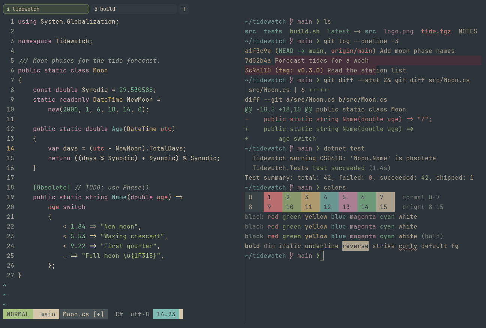

# Everforest Dark

Dark. Upstream: Everforest.



## What it looks like

Warm beige text on a green-grey forest background (#2d353b). The accents are soft pastels: coral red, leaf green, sand
yellow, sea blue, pink and mint. Gentle on the eyes.

## Where it comes from

From [Everforest](https://github.com/sainnhe/everforest) by sainnhe (the vim palette; there is no official terminal
port). MIT license.

## Use it

```toml
color_scheme = "Everforest Dark"
```

Its accent, which colors the active tab, focus marks and palette highlights, is `#a7c080` (green). `[colors] accent`
in your config overrides it.

## Accessibility

Measured from the pixels of the screenshot above (focused editor) and of the same scene with the editor in the
inactive pane (dimmed by the default `inactive_pane_hsb`): the statusline's text against its own block.

| Statusline block | Focused | Dimmed | Without the contrast default |
|---|---|---|---|
| NORMAL (black on green) | 4.61:1 | 3.75:1 | 4.08:1 / 3.42:1 |
| main (black on white) | 4.83:1 | 3.98:1 | 4.83:1 / 3.98:1 |
| Moon.cs [+] (white on bright black) | 4.75:1 | 3.92:1 | 4.75:1 / 3.92:1 |
| C# utf-8 (bright black text) | 4.53:1 | 3.03:1 | 1.55:1 / 1.22:1 |
| 14:23 (black on blue) | 4.52:1 | 3.63:1 | 3.7:1 / 3.12:1 |

Lowest: 4.52:1 focused (target 4.5:1, WCAG AA) and 3.03:1 dimmed (target 3:1). Body text: 7.4:1.

The built-in contrast default (`minimum_contrast = 4.5`) does the work here. As published, these are below 4.5:1, and
erikterm draws them lighter or darker, keeping their hue, until they reach it: text in black (1.6:1), bright black
(1.6:1); black text on green (4:1), blue (3.7:1). The palette is as published, not adapted. With `minimum_contrast =
1` in your config you get the published colors as they are; the notes below describe those.

Everforest has no separate brights: they repeat the normal colors, so bright black is the same grey as black.

## See also

- [Everforest Light](everforest-light.md)
- [Gruvbox Dark](gruvbox-dark.md)
- [Kanagawa Wave](kanagawa-wave.md)
- [All color schemes](README.md)
