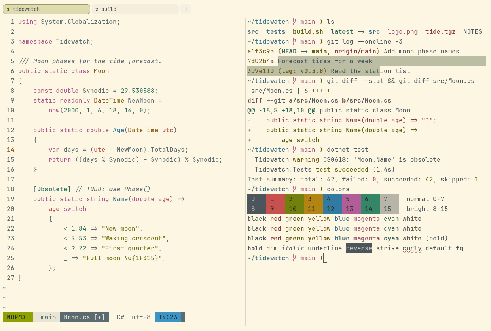

# Everforest Light

Light. Upstream: Everforest.



## What it looks like

Grey-green text on warm cream (#fdf6e3). The accents are bright and pale: red, lime green, yellow, blue, pink and
teal. Light and airy.

## Where it comes from

From [Everforest](https://github.com/sainnhe/everforest) by sainnhe. MIT license.

## Use it

```toml
color_scheme = "Everforest Light"
```

Its accent, which colors the active tab, focus marks and palette highlights, is `#809201` (green). `[colors] accent`
in your config overrides it.

## Accessibility

Measured from the pixels of the screenshot above (focused editor) and of the same scene with the editor in the
inactive pane (dimmed by the default `inactive_pane_hsb`): the statusline's text against its own block.

| Statusline block | Focused | Dimmed | Without the contrast default |
|---|---|---|---|
| NORMAL (black on green) | 4.6:1 | 3.5:1 | 1.95:1 / 1.8:1 |
| main (black on white) | 4.61:1 | 3.93:1 | 4.35:1 / 3.76:1 |
| Moon.cs [+] (white on bright black) | 4.5:1 | 3.88:1 | 4.29:1 / 3.71:1 |
| C# utf-8 (bright black text) | 5.26:1 | 7.19:1 | 5.26:1 / 7.19:1 |
| 14:23 (black on blue) | 4.54:1 | 3.56:1 | 1.68:1 / 1.64:1 |

Lowest: 4.5:1 focused (target 4.5:1, WCAG AA) and 3.5:1 dimmed (target 3:1). Body text: 5.2:1.

The built-in contrast default (`minimum_contrast = 4.5`) does the work here. As published, these are below 4.5:1, and
erikterm draws them lighter or darker, keeping their hue, until they reach it: text in red (3:1), green (2.7:1),
yellow (2.1:1), blue (3.1:1), magenta (2.8:1), cyan (2.8:1), white (1.2:1), bright red (3:1), bright green (2.7:1),
bright yellow (2.1:1), bright blue (3.1:1), bright magenta (2.8:1), bright cyan (2.8:1), bright white (1.2:1); black
text on green (1.9:1), white (4.3:1), blue (1.7:1); white text on bright black (4.3:1); bright white text on bright
black (4.3:1). The palette is as published, not adapted. With `minimum_contrast = 1` in your config you get the
published colors as they are; the notes below describe those.

The upstream accents are pale for a light background: most of them read weakly as text.

## See also

- [Everforest Dark](everforest-dark.md)
- [Gruvbox Light](gruvbox-light.md)
- [Sage Garden](sage-garden.md)
- [All color schemes](README.md)
