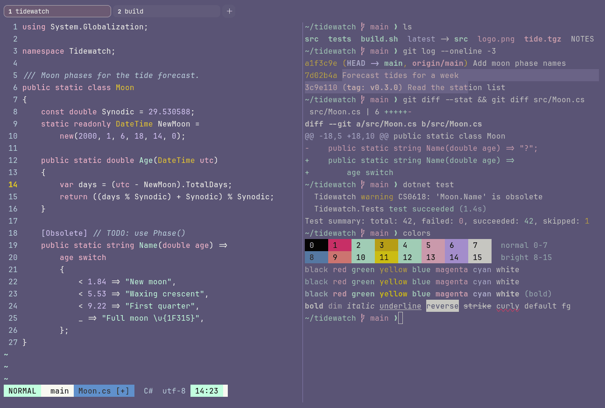

# Fairy Floss

Dark. Upstream: Fairy Floss.



## What it looks like

Off-white text on dusty purple (#5a5475). The accents are candy-floss pastels: hot pink, mint, gold, pink and lilac.
Sweet and soft.

## Where it comes from

From [fairyfloss](https://github.com/sailorhg/fairyfloss) by sailorhg. MIT license (stated in package.json). The
upstream theme has no terminal palette; the ANSI mapping follows the iTerm2-Color-Schemes port, which uses only
fairyfloss colors.

## Use it

```toml
color_scheme = "Fairy Floss"
```

Its accent, which colors the active tab, focus marks and palette highlights, is `#ffb8d1` (pink). `[colors] accent` in
your config overrides it.

## Accessibility

Measured from the pixels of the screenshot above (focused editor) and of the same scene with the editor in the
inactive pane (dimmed by the default `inactive_pane_hsb`): the statusline's text against its own block.

| Statusline block | Focused | Dimmed | Without the contrast default |
|---|---|---|---|
| NORMAL (black on green) | 18.34:1 | 11.71:1 | 18.34:1 / 11.71:1 |
| main (black on white) | 19.42:1 | 12.16:1 | 19.42:1 / 12.16:1 |
| Moon.cs [+] (white on bright black) | 4.58:1 | 3.65:1 | 3.1:1 / 2.67:1 |
| C# utf-8 (bright black text) | 4.51:1 | 3.0:1 | 2.15:1 / 1.55:1 |
| 14:23 (black on blue) | 18.31:1 | 11.64:1 | 18.31:1 / 11.64:1 |

Lowest: 4.51:1 focused (target 4.5:1, WCAG AA) and 3.0:1 dimmed (target 3:1). Body text: 6.7:1.

The built-in contrast default (`minimum_contrast = 4.5`) does the work here. As published, these are below 4.5:1, and
erikterm draws them lighter or darker, keeping their hue, until they reach it: text in black (2.9:1), red (1.9:1),
yellow (4:1), magenta (4.4:1), cyan (3.4:1), bright black (2.1:1), bright red (3:1), bright magenta (4.4:1), bright
cyan (3.4:1); white text on bright black (3.1:1); bright white text on bright black (3.1:1). The palette is as
published, not adapted. With `minimum_contrast = 1` in your config you get the published colors as they are; the notes
below describe those.

Green and blue are the same mint, so programs that tell them apart show them alike. Upstream red is a hot pink that is
dark on this background, which matters for errors and diff deletions.

## See also

- [LaserWave](laserwave.md)
- [Shades of Purple](shades-of-purple.md)
- [Cherry Blossom](cherry-blossom.md)
- [All color schemes](README.md)
