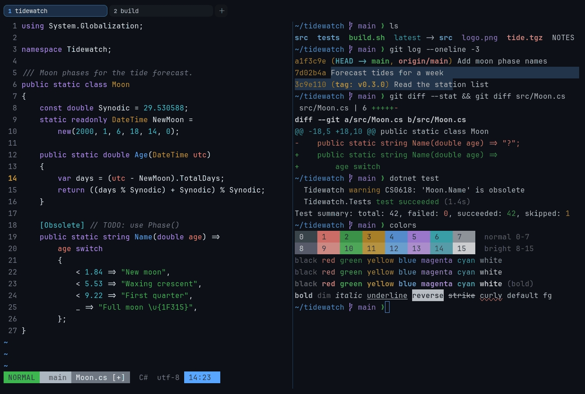

# GitHub Dark

Dark. Upstream: GitHub.



## What it looks like

Near-white text on GitHub's navy-black (#0d1117). The accents are clear and saturated: coral red, green, amber, blue,
purple and cyan. It looks like github.com in dark mode.

## Where it comes from

From GitHub's [Primer](https://github.com/primer/github-vscode-theme) design system (the GitHub VS Code theme and
@primer/primitives). MIT license.

## Use it

```toml
color_scheme = "GitHub Dark"
```

Its accent, which colors the active tab, focus marks and palette highlights, is `#58a6ff` (blue). `[colors] accent` in
your config overrides it.

## Accessibility

Measured from the pixels of the screenshot above (focused editor) and of the same scene with the editor in the
inactive pane (dimmed by the default `inactive_pane_hsb`): the statusline's text against its own block.

| Statusline block | Focused | Dimmed | Without the contrast default |
|---|---|---|---|
| NORMAL (black on green) | 4.58:1 | 3.59:1 | 3.31:1 / 2.79:1 |
| main (black on white) | 4.62:1 | 3.76:1 | 4.28:1 / 3.55:1 |
| Moon.cs [+] (white on bright black) | 4.51:1 | 3.92:1 | 2.34:1 / 2.15:1 |
| C# utf-8 (bright black text) | 4.54:1 | 3.21:1 | 4.12:1 / 2.94:1 |
| 14:23 (black on blue) | 4.54:1 | 3.86:1 | 3.29:1 / 3.0:1 |

Lowest: 4.51:1 focused (target 4.5:1, WCAG AA) and 3.21:1 dimmed (target 3:1). Body text: 16:1.

The built-in contrast default (`minimum_contrast = 4.5`) does the work here. As published, these are below 4.5:1, and
erikterm draws them lighter or darker, keeping their hue, until they reach it: text in black (2.3:1), bright black
(4.1:1); black text on green (3.3:1), white (4.2:1), blue (3.3:1); white text on bright black (2.3:1). The palette is
as published, not adapted. With `minimum_contrast = 1` in your config you get the published colors as they are; the
notes below describe those.

## See also

- [GitHub Light](github-light.md)
- [One Half Dark](one-half-dark.md)
- [Carbonfox](carbonfox.md)
- [All color schemes](README.md)
