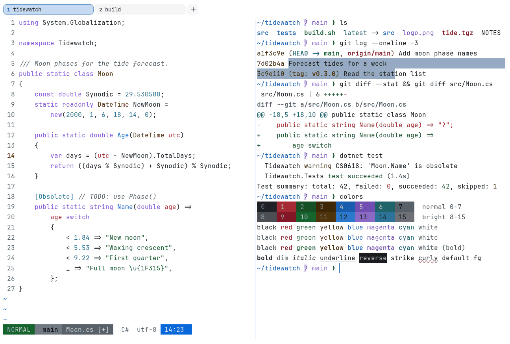

# GitHub Light

Light. Upstream: GitHub.



## What it looks like

Near-black text on pure white (#ffffff). The accents are dark and clear: red, forest green, brown, blue, purple and
teal. Crisp and plain, like github.com.

## Where it comes from

From GitHub's [Primer](https://github.com/primer/github-vscode-theme) design system (the GitHub VS Code theme and
@primer/primitives). MIT license.

## Use it

```toml
color_scheme = "GitHub Light"
```

Its accent, which colors the active tab, focus marks and palette highlights, is `#0969da` (blue). `[colors] accent` in
your config overrides it.

## Accessibility

Measured from the pixels of the screenshot above (focused editor) and of the same scene with the editor in the
inactive pane (dimmed by the default `inactive_pane_hsb`): the statusline's text against its own block.

| Statusline block | Focused | Dimmed | Without the contrast default |
|---|---|---|---|
| NORMAL (black on green) | 4.5:1 | 3.77:1 | 2.01:1 / 1.69:1 |
| main (black on white) | 4.53:1 | 3.26:1 | 3.27:1 / 2.57:1 |
| Moon.cs [+] (white on bright black) | 4.51:1 | 3.79:1 | 1.41:1 / 1.33:1 |
| C# utf-8 (bright black text) | 6.39:1 | 8.44:1 | 6.39:1 / 8.44:1 |
| 14:23 (black on blue) | 4.51:1 | 3.54:1 | 2.86:1 / 2.5:1 |

Lowest: 4.5:1 focused (target 4.5:1, WCAG AA) and 3.26:1 dimmed (target 3:1). Body text: 16:1.

The built-in contrast default (`minimum_contrast = 4.5`) does the work here. As published, these are below 4.5:1, and
erikterm draws them lighter or darker, keeping their hue, until they reach it: text in bright blue (3.4:1), bright
magenta (3.2:1), bright cyan (3.6:1), bright white (3:1); black text on green (2:1), white (3.2:1), blue (2.8:1);
white text on bright black (1.4:1); bright white text on bright black (2.1:1). The palette is as published, not
adapted. With `minimum_contrast = 1` in your config you get the published colors as they are; the notes below describe
those.

Every text color is dark enough to read on white. The other side of that: black text on colored blocks (prompt and
statusline segments) is weak.

## See also

- [GitHub Dark](github-dark.md)
- [One Half Light](one-half-light.md)
- [Solarized Light](solarized-light.md)
- [All color schemes](README.md)
