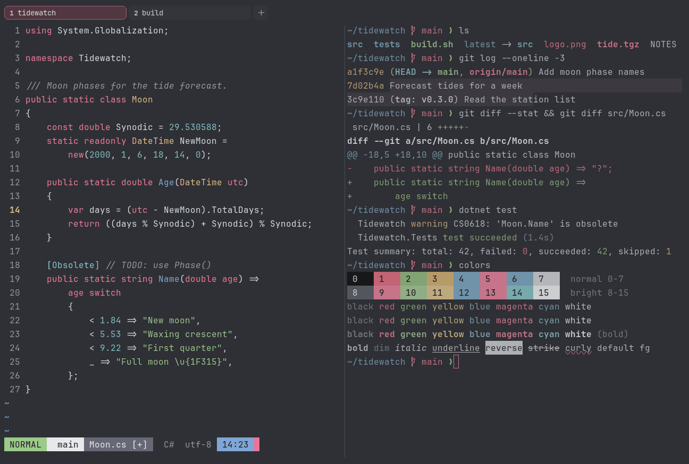

# Graphite & Blush

Dark. Original for erikterm.



## What it looks like

Light grey text on cool graphite (#2e3035). The accents are coral red, sage green, sand, blue, a loud pink and teal.
Mostly grey, with one bright pink.

## Where it comes from

Made for erikterm, inspired by grey keycap sets with a single pink accent. Seed colors were chosen by eye, then
adjusted to the contrast floors.

## Use it

```toml
color_scheme = "Graphite & Blush"
```

Its accent, which colors the active tab, focus marks and palette highlights, is `#f2779b` (pink). `[colors] accent` in
your config overrides it.

## Accessibility

Measured from the pixels of the screenshot above (focused editor) and of the same scene with the editor in the
inactive pane (dimmed by the default `inactive_pane_hsb`): the statusline's text against its own block.

| Statusline block | Focused | Dimmed | Without the contrast default |
|---|---|---|---|
| NORMAL (black on green) | 9.18:1 | 6.28:1 | 9.18:1 / 6.28:1 |
| main (black on white) | 14.01:1 | 9.33:1 | 14.01:1 / 9.33:1 |
| Moon.cs [+] (white on bright black) | 4.62:1 | 3.93:1 | 4.62:1 / 3.93:1 |
| C# utf-8 (bright black text) | 4.53:1 | 3.07:1 | 2.35:1 / 1.75:1 |
| 14:23 (black on blue) | 6.69:1 | 4.93:1 | 6.69:1 / 4.93:1 |

Lowest: 4.53:1 focused (target 4.5:1, WCAG AA) and 3.07:1 dimmed (target 3:1). Body text: 9.5:1.

The palette itself is made for these targets: black text on every color and white text on bright black reach 4.6:1 or
more without any help, and the other colors read at 3:1 or better as text. Bright black is 2.4:1 as text: it is kept
dark enough to carry white text as a block, and the built-in contrast default (`minimum_contrast = 4.5`) lifts it to
4.5:1 where it is text (the C# utf-8 row), like any color used as text below 4.5:1.

## See also

- [Onyx & Rose](onyx-and-rose.md)
- [Coral Navy](coral-navy.md)
- [Neon Grid](neon-grid.md)
- [All color schemes](README.md)
