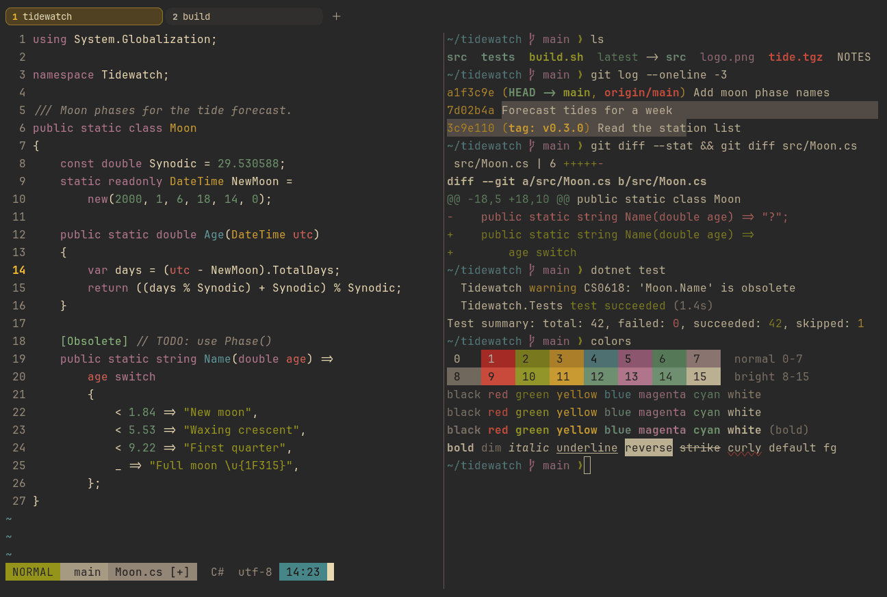

# Gruvbox Dark

Dark. Upstream: Gruvbox.



## What it looks like

Cream text on a warm dark grey (#282828). The accents are retro earth tones: brick red, olive green, mustard, teal
blue, plum and sage, with brighter versions as brights. Warm and relaxed.

## Where it comes from

From [gruvbox](https://github.com/morhetz/gruvbox) by Pavel Pertsev (morhetz). MIT license (stated in the project's
README and package.json).

## Use it

```toml
color_scheme = "Gruvbox Dark"
```

Its accent, which colors the active tab, focus marks and palette highlights, is `#fabd2f` (yellow). `[colors] accent`
in your config overrides it.

## Accessibility

Measured from the pixels of the screenshot above (focused editor) and of the same scene with the editor in the
inactive pane (dimmed by the default `inactive_pane_hsb`): the statusline's text against its own block.

| Statusline block | Focused | Dimmed | Without the contrast default |
|---|---|---|---|
| NORMAL (black on green) | 4.82:1 | 3.6:1 | 4.82:1 / 3.6:1 |
| main (black on white) | 5.37:1 | 4.01:1 | 5.37:1 / 4.01:1 |
| Moon.cs [+] (white on bright black) | 4.57:1 | 3.39:1 | 1.32:1 / 1.28:1 |
| C# utf-8 (bright black text) | 4.51:1 | 3.09:1 | 4.02:1 / 2.8:1 |
| 14:23 (black on blue) | 4.54:1 | 3.3:1 | 3.49:1 / 2.76:1 |

Lowest: 4.51:1 focused (target 4.5:1, WCAG AA) and 3.09:1 dimmed (target 3:1). Body text: 11:1.

The built-in contrast default (`minimum_contrast = 4.5`) does the work here. As published, these are below 4.5:1, and
erikterm draws them lighter or darker, keeping their hue, until they reach it: text in black (1:1), red (2.7:1), blue
(3.5:1), magenta (3.5:1), bright black (4:1), bright red (4.3:1); black text on blue (3.5:1); white text on bright
black (1.3:1); bright white text on bright black (2.7:1). The palette is as published, not adapted. With
`minimum_contrast = 1` in your config you get the published colors as they are; the notes below describe those.

Upstream red is a deep brick red, the weakest text color. ANSI black is the background color.

## See also

- [Gruvbox Light](gruvbox-light.md)
- [Everforest Dark](everforest-dark.md)
- [Kanagawa Wave](kanagawa-wave.md)
- [All color schemes](README.md)
