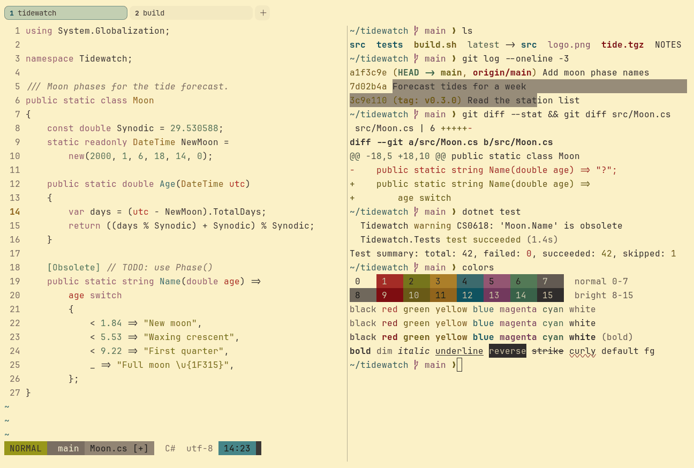

# Gruvbox Light

Light. Upstream: Gruvbox.



## What it looks like

Dark brown-grey text on cream paper (#fbf1c7). The same retro earth tones as Gruvbox Dark, with darker brights: brick
red, olive, mustard, teal, plum and sage. Warm, like an old paperback.

## Where it comes from

From [gruvbox](https://github.com/morhetz/gruvbox) by Pavel Pertsev (morhetz). MIT license (stated in the project's
README and package.json).

## Use it

```toml
color_scheme = "Gruvbox Light"
```

Its accent, which colors the active tab, focus marks and palette highlights, is `#076678` (deep teal). `[colors]
accent` in your config overrides it.

## Accessibility

Measured from the pixels of the screenshot above (focused editor) and of the same scene with the editor in the
inactive pane (dimmed by the default `inactive_pane_hsb`): the statusline's text against its own block.

| Statusline block | Focused | Dimmed | Without the contrast default |
|---|---|---|---|
| NORMAL (black on green) | 4.57:1 | 3.47:1 | 2.73:1 / 2.56:1 |
| main (black on white) | 4.53:1 | 3.93:1 | 4.29:1 / 3.77:1 |
| Moon.cs [+] (white on bright black) | 4.56:1 | 3.38:1 | 1.35:1 / 1.3:1 |
| C# utf-8 (bright black text) | 4.57:1 | 6.32:1 | 3.28:1 / 4.72:1 |
| 14:23 (black on blue) | 4.51:1 | 3.28:1 | 3.73:1 / 3.33:1 |

Lowest: 4.51:1 focused (target 4.5:1, WCAG AA) and 3.28:1 dimmed (target 3:1). Body text: 10:1.

The built-in contrast default (`minimum_contrast = 4.5`) does the work here. As published, these are below 4.5:1, and
erikterm draws them lighter or darker, keeping their hue, until they reach it: text in black (1:1), green (2.7:1),
yellow (2.2:1), blue (3.7:1), magenta (3.7:1), cyan (2.8:1), white (4.3:1), bright black (3.2:1), bright green
(4.3:1), bright yellow (3.3:1), bright cyan (4.4:1); black text on green (2.7:1), white (4.3:1), blue (3.7:1); white
text on bright black (1.3:1); bright white text on bright black (3.2:1). The palette is as published, not adapted.
With `minimum_contrast = 1` in your config you get the published colors as they are; the notes below describe those.

Upstream green, yellow and cyan are light for a cream background.

## See also

- [Gruvbox Dark](gruvbox-dark.md)
- [Everforest Light](everforest-light.md)
- [Solarized Light](solarized-light.md)
- [All color schemes](README.md)
