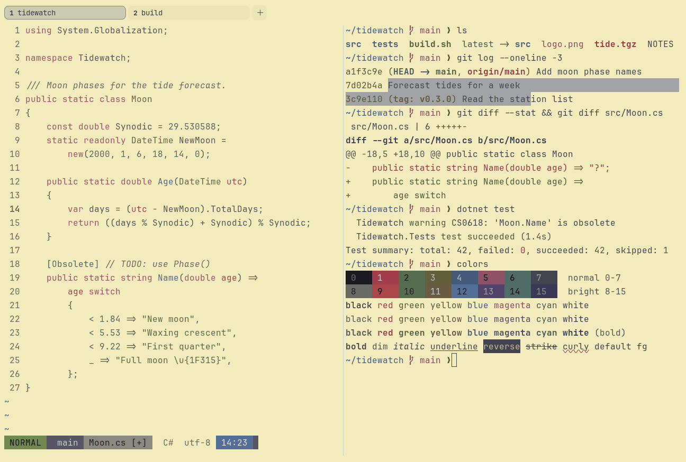

# Kanagawa Lotus

Light. Upstream: Kanagawa.



## What it looks like

Grey-violet text on yellowed paper (#f2ecbc). The accents are deep and quiet: red, moss green, olive, blue, rose and
grey-teal. The light side of Kanagawa.

## Where it comes from

From [kanagawa.nvim](https://github.com/rebelot/kanagawa.nvim) by Tommaso Laurenzi (rebelot). MIT license.

## Use it

```toml
color_scheme = "Kanagawa Lotus"
```

Its accent, which colors the active tab, focus marks and palette highlights, is `#4d699b` (blue). `[colors] accent` in
your config overrides it.

## Accessibility

Measured from the pixels of the screenshot above (focused editor) and of the same scene with the editor in the
inactive pane (dimmed by the default `inactive_pane_hsb`): the statusline's text against its own block.

| Statusline block | Focused | Dimmed | Without the contrast default |
|---|---|---|---|
| NORMAL (black on green) | 4.55:1 | 3.31:1 | 4.22:1 / 3.13:1 |
| main (black on white) | 4.54:1 | 3.76:1 | 2.23:1 / 1.82:1 |
| Moon.cs [+] (white on bright black) | 4.6:1 | 3.38:1 | 2.14:1 / 1.9:1 |
| C# utf-8 (bright black text) | 4.59:1 | 6.32:1 | 2.97:1 / 4.34:1 |
| 14:23 (black on blue) | 4.5:1 | 3.69:1 | 3.0:1 / 2.44:1 |

Lowest: 4.5:1 focused (target 4.5:1, WCAG AA) and 3.31:1 dimmed (target 3:1). Body text: 6.2:1.

The built-in contrast default (`minimum_contrast = 4.5`) does the work here. As published, these are below 4.5:1, and
erikterm draws them lighter or darker, keeping their hue, until they reach it: text in red (4.1:1), green (3.3:1),
yellow (4.1:1), magenta (3.7:1), cyan (3.9:1), bright black (2.9:1), bright red (3.6:1), bright green (3:1), bright
yellow (4:1), bright blue (2.7:1), bright cyan (3.4:1); black text on green (4.2:1), white (2.2:1), blue (3:1); white
text on bright black (2.1:1); bright white text on bright black (2.6:1). The palette is as published, not adapted.
With `minimum_contrast = 1` in your config you get the published colors as they are; the notes below describe those.

Body text is a soft grey-violet, not black, so the scheme reads quieter than most light schemes.

## See also

- [Kanagawa Wave](kanagawa-wave.md)
- [Gruvbox Light](gruvbox-light.md)
- [Everforest Light](everforest-light.md)
- [All color schemes](README.md)
