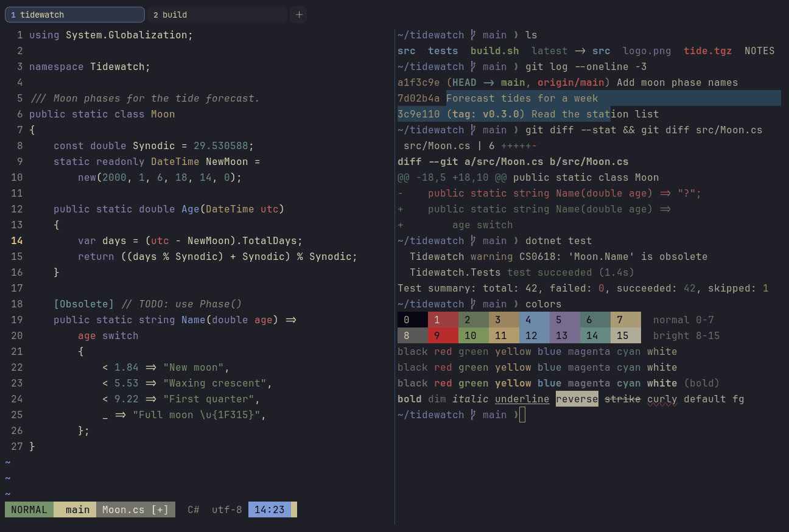

# Kanagawa Wave

Dark. Upstream: Kanagawa.



## What it looks like

Parchment text on ink blue-black (#1f1f28). The accents are dusty, like old woodblock prints: autumn red, spring
green, boat yellow, crystal blue, violet and wave aqua. Muted and painterly.

## Where it comes from

From [kanagawa.nvim](https://github.com/rebelot/kanagawa.nvim) by Tommaso Laurenzi (rebelot), inspired by Katsushika
Hokusai's The Great Wave off Kanagawa. MIT license.

## Use it

```toml
color_scheme = "Kanagawa Wave"
```

Its accent, which colors the active tab, focus marks and palette highlights, is `#7e9cd8` (crystal blue). `[colors]
accent` in your config overrides it.

## Accessibility

Measured from the pixels of the screenshot above (focused editor) and of the same scene with the editor in the
inactive pane (dimmed by the default `inactive_pane_hsb`): the statusline's text against its own block.

| Statusline block | Focused | Dimmed | Without the contrast default |
|---|---|---|---|
| NORMAL (black on green) | 5.95:1 | 4.08:1 | 5.95:1 / 4.08:1 |
| main (black on white) | 10.93:1 | 7.12:1 | 10.93:1 / 7.12:1 |
| Moon.cs [+] (white on bright black) | 4.53:1 | 4.0:1 | 2.67:1 / 2.43:1 |
| C# utf-8 (bright black text) | 4.52:1 | 3.1:1 | 3.33:1 / 2.36:1 |
| 14:23 (black on blue) | 7.27:1 | 5.2:1 | 7.27:1 / 5.2:1 |

Lowest: 4.52:1 focused (target 4.5:1, WCAG AA) and 3.1:1 dimmed (target 3:1). Body text: 11:1.

The built-in contrast default (`minimum_contrast = 4.5`) does the work here. As published, these are below 4.5:1, and
erikterm draws them lighter or darker, keeping their hue, until they reach it: text in black (1.2:1), red (3.2:1),
bright black (3.3:1), bright red (3.7:1); white text on bright black (2.7:1); bright white text on bright black
(3.4:1). The palette is as published, not adapted. With `minimum_contrast = 1` in your config you get the published
colors as they are; the notes below describe those.

## See also

- [Kanagawa Lotus](kanagawa-lotus.md)
- [Rosé Pine](rose-pine.md)
- [Everforest Dark](everforest-dark.md)
- [All color schemes](README.md)
