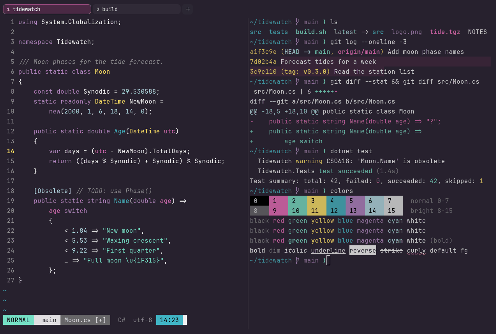

# LaserWave

Dark. Upstream: LaserWave.



## What it looks like

White text on aubergine (#27212e). The accents are a softer synthwave: pink, aqua, lemon, teal, lilac and pale blue.
Retro without the glare.

## Where it comes from

From [LaserWave](https://github.com/Jaredk3nt/laserwave) by Jared Jones. MIT license. The upstream theme defines only
red to cyan; black and white are VS Code's defaults.

## Use it

```toml
color_scheme = "LaserWave"
```

Its accent, which colors the active tab, focus marks and palette highlights, is `#eb64b9` (pink). `[colors] accent` in
your config overrides it.

## Accessibility

Measured from the pixels of the screenshot above (focused editor) and of the same scene with the editor in the
inactive pane (dimmed by the default `inactive_pane_hsb`): the statusline's text against its own block.

| Statusline block | Focused | Dimmed | Without the contrast default |
|---|---|---|---|
| NORMAL (black on green) | 13.09:1 | 8.42:1 | 13.09:1 / 8.42:1 |
| main (black on white) | 16.67:1 | 10.47:1 | 16.67:1 / 10.47:1 |
| Moon.cs [+] (white on bright black) | 4.56:1 | 3.9:1 | 4.56:1 / 3.9:1 |
| C# utf-8 (bright black text) | 4.53:1 | 3.07:1 | 2.72:1 / 2.0:1 |
| 14:23 (black on blue) | 8.54:1 | 5.74:1 | 8.54:1 / 5.74:1 |

Lowest: 4.53:1 focused (target 4.5:1, WCAG AA) and 3.07:1 dimmed (target 3:1). Body text: 16:1.

The built-in contrast default (`minimum_contrast = 4.5`) does the work here. As published, these are below 4.5:1, and
erikterm draws them lighter or darker, keeping their hue, until they reach it: text in black (1.3:1), bright black
(2.7:1). The palette is as published, not adapted. With `minimum_contrast = 1` in your config you get the published
colors as they are; the notes below describe those.

The brights repeat the normal colors upstream, so bold or bright text doesn't change color.

## See also

- [SynthWave '84](synthwave-84.md)
- [Fairy Floss](fairy-floss.md)
- [Neon Grid](neon-grid.md)
- [All color schemes](README.md)
