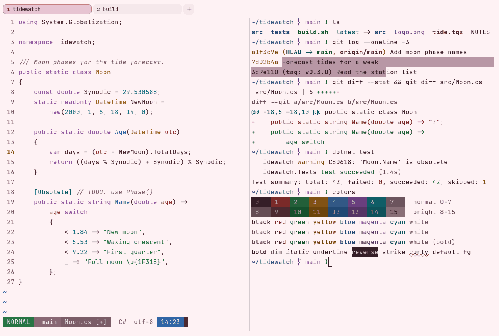

# Lumina Oxblood Light

Light. Upstream: Lumina.



## What it looks like

Oxblood-brown text on very pale pink (#fef2f4). The accents are deep: brick red, forest green, amber, blue, plum and
teal. A light pink scheme that stays readable.

## Where it comes from

From [lumina-themes](https://github.com/RazikSF/lumina-themes) by Razik Ikhlef. MIT license.

## Use it

```toml
color_scheme = "Lumina Oxblood Light"
```

Its accent, which colors the active tab, focus marks and palette highlights, is `#a62d66` (oxblood). `[colors] accent`
in your config overrides it.

## Accessibility

Measured from the pixels of the screenshot above (focused editor) and of the same scene with the editor in the
inactive pane (dimmed by the default `inactive_pane_hsb`): the statusline's text against its own block.

| Statusline block | Focused | Dimmed | Without the contrast default |
|---|---|---|---|
| NORMAL (black on green) | 4.51:1 | 3.89:1 | 2.56:1 / 2.05:1 |
| main (black on white) | 4.5:1 | 3.82:1 | 2.8:1 / 2.27:1 |
| Moon.cs [+] (white on bright black) | 4.53:1 | 3.8:1 | 1.14:1 / 1.12:1 |
| C# utf-8 (bright black text) | 5.36:1 | 7.14:1 | 5.36:1 / 7.14:1 |
| 14:23 (black on blue) | 4.52:1 | 3.6:1 | 2.41:1 / 2.1:1 |

Lowest: 4.5:1 focused (target 4.5:1, WCAG AA) and 3.6:1 dimmed (target 3:1). Body text: 13:1.

The built-in contrast default (`minimum_contrast = 4.5`) does the work here. As published, these are below 4.5:1, and
erikterm draws them lighter or darker, keeping their hue, until they reach it: text in bright white (3:1); black text
on green (2.5:1), white (2.8:1), blue (2.4:1); white text on bright black (1.1:1); bright white text on bright black
(1.8:1). The palette is as published, not adapted. With `minimum_contrast = 1` in your config you get the published
colors as they are; the notes below describe those.

Every color is dark enough to read as text. The other side of that: black text on colored blocks (prompt and
statusline segments) is weak.

## See also

- [Blossom](blossom.md)
- [Cream & Rose](cream-and-rose.md)
- [GitHub Light](github-light.md)
- [All color schemes](README.md)
