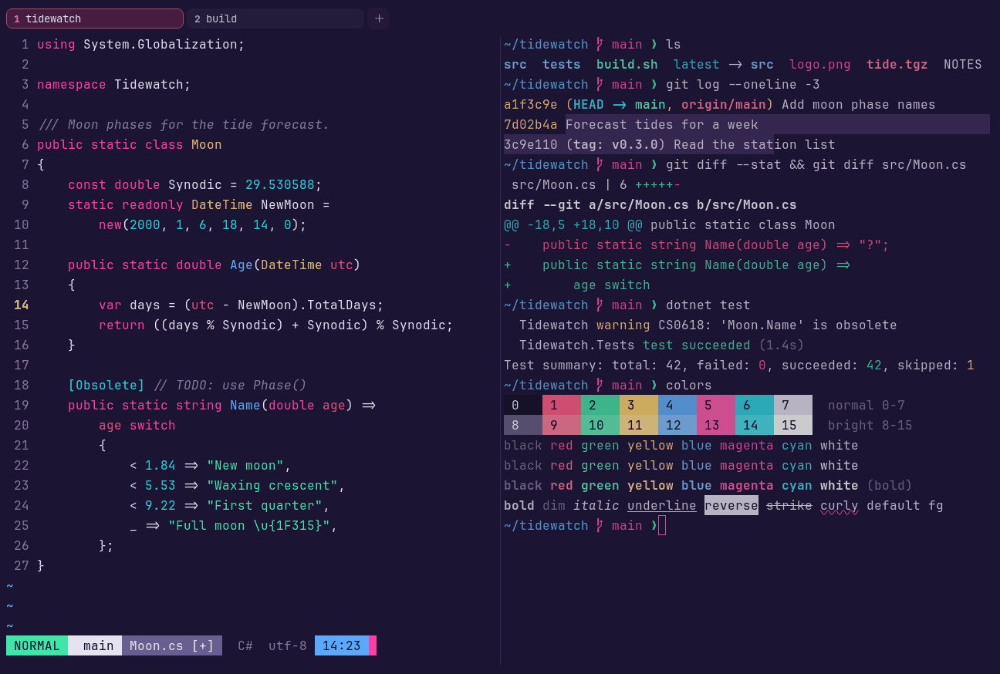

# Neon Grid

Dark. Original for erikterm.



## What it looks like

Lavender text on deep violet (#1c1433). The accents are neon: hot red, mint, gold, blue, magenta and cyan.
Retro-futurist, like a synthwave sunset grid.

## Where it comes from

Made for erikterm, inspired by retro-futurist keycap sets in dark purple with magenta and cyan. Seed colors were
chosen by eye, then adjusted to the contrast floors.

## Use it

```toml
color_scheme = "Neon Grid"
```

Its accent, which colors the active tab, focus marks and palette highlights, is `#ff3ea5` (magenta). `[colors] accent`
in your config overrides it.

## Accessibility

Measured from the pixels of the screenshot above (focused editor) and of the same scene with the editor in the
inactive pane (dimmed by the default `inactive_pane_hsb`): the statusline's text against its own block.

| Statusline block | Focused | Dimmed | Without the contrast default |
|---|---|---|---|
| NORMAL (black on green) | 11.94:1 | 7.78:1 | 11.94:1 / 7.78:1 |
| main (black on white) | 15.17:1 | 9.78:1 | 15.17:1 / 9.78:1 |
| Moon.cs [+] (white on bright black) | 4.63:1 | 3.84:1 | 4.63:1 / 3.84:1 |
| C# utf-8 (bright black text) | 4.51:1 | 3.23:1 | 3.0:1 / 2.31:1 |
| 14:23 (black on blue) | 7.75:1 | 5.62:1 | 7.75:1 / 5.62:1 |

Lowest: 4.51:1 focused (target 4.5:1, WCAG AA) and 3.23:1 dimmed (target 3:1). Body text: 13:1.

The palette itself is made for these targets: black text on every color and white text on bright black reach 4.6:1 or
more without any help, and the other colors read at 3:1 or better as text. Bright black is 3:1 as text: it is kept
dark enough to carry white text as a block, and the built-in contrast default (`minimum_contrast = 4.5`) lifts it to
4.5:1 where it is text (the C# utf-8 row), like any color used as text below 4.5:1.

## See also

- [SynthWave '84](synthwave-84.md)
- [LaserWave](laserwave.md)
- [Cyberpunk](cyberpunk.md)
- [All color schemes](README.md)
