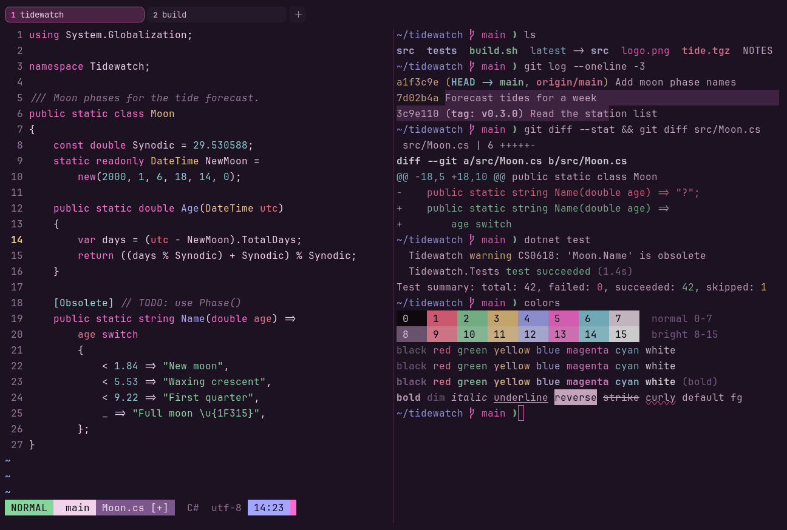

# Night Blossom

Dark. Original for erikterm.



## What it looks like

Pink-tinted text on deep plum (#1c1222). The accents are rose red, mint, gold, periwinkle, hot pink and sky blue.
Cherry blossom at night.

## Where it comes from

Made for erikterm: a sakura-style dark pink scheme with the usual ANSI roles, so red still means errors and green
success. Seed colors were chosen by eye, then adjusted to the contrast floors.

## Use it

```toml
color_scheme = "Night Blossom"
```

Its accent, which colors the active tab, focus marks and palette highlights, is `#ff6fd2` (pink). `[colors] accent` in
your config overrides it.

## Accessibility

Measured from the pixels of the screenshot above (focused editor) and of the same scene with the editor in the
inactive pane (dimmed by the default `inactive_pane_hsb`): the statusline's text against its own block.

| Statusline block | Focused | Dimmed | Without the contrast default |
|---|---|---|---|
| NORMAL (black on green) | 11.5:1 | 7.52:1 | 11.5:1 / 7.52:1 |
| main (black on white) | 15.69:1 | 10.09:1 | 15.69:1 / 10.09:1 |
| Moon.cs [+] (white on bright black) | 4.61:1 | 3.83:1 | 4.61:1 / 3.83:1 |
| C# utf-8 (bright black text) | 4.51:1 | 3.26:1 | 3.09:1 / 2.37:1 |
| 14:23 (black on blue) | 8.93:1 | 6.38:1 | 8.93:1 / 6.38:1 |

Lowest: 4.51:1 focused (target 4.5:1, WCAG AA) and 3.26:1 dimmed (target 3:1). Body text: 12:1.

The palette itself is made for these targets: black text on every color and white text on bright black reach 4.6:1 or
more without any help, and the other colors read at 3:1 or better as text. Bright black is 3.1:1 as text: it is kept
dark enough to carry white text as a block, and the built-in contrast default (`minimum_contrast = 4.5`) lifts it to
4.5:1 where it is text (the C# utf-8 row), like any color used as text below 4.5:1.

## See also

- [Blossom](blossom.md)
- [Shado](shado.md)
- [Cherry Blossom](cherry-blossom.md)
- [All color schemes](README.md)
