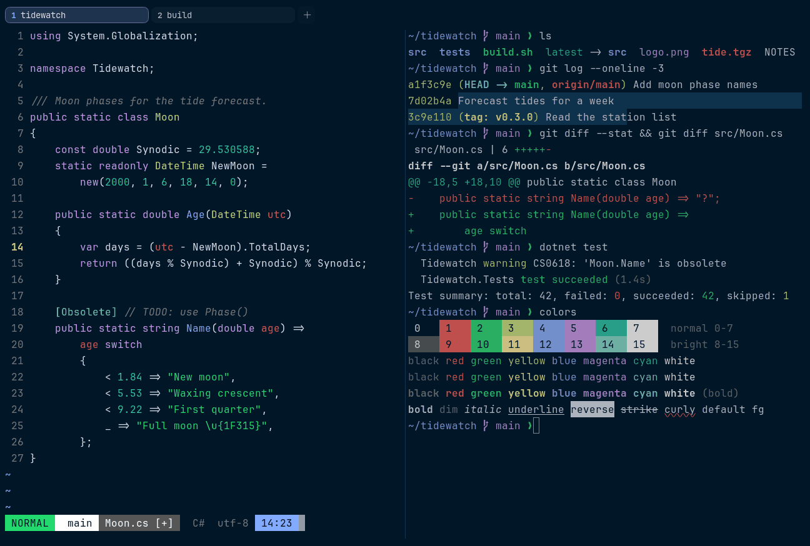

# Night Owl

Dark. Upstream: Night Owl.



## What it looks like

Light blue-grey text on deep midnight blue (#011627). The accents are bright: red, green, lime yellow, blue, lilac and
teal. Made for coding late at night.

## Where it comes from

From [Night Owl](https://github.com/sdras/night-owl-vscode-theme) by Sarah Drasner. MIT license.

## Use it

```toml
color_scheme = "Night Owl"
```

Its accent, which colors the active tab, focus marks and palette highlights, is `#82aaff` (blue). `[colors] accent` in
your config overrides it.

## Accessibility

Measured from the pixels of the screenshot above (focused editor) and of the same scene with the editor in the
inactive pane (dimmed by the default `inactive_pane_hsb`): the statusline's text against its own block.

| Statusline block | Focused | Dimmed | Without the contrast default |
|---|---|---|---|
| NORMAL (black on green) | 9.97:1 | 6.6:1 | 9.97:1 / 6.6:1 |
| main (black on white) | 18.33:1 | 11.79:1 | 18.33:1 / 11.79:1 |
| Moon.cs [+] (white on bright black) | 7.32:1 | 5.95:1 | 7.32:1 / 5.95:1 |
| C# utf-8 (bright black text) | 4.52:1 | 3.15:1 | 2.51:1 / 1.92:1 |
| 14:23 (black on blue) | 7.98:1 | 5.83:1 | 7.98:1 / 5.83:1 |

Lowest: 4.52:1 focused (target 4.5:1, WCAG AA) and 3.15:1 dimmed (target 3:1). Body text: 14:1.

The built-in contrast default (`minimum_contrast = 4.5`) does the work here. As published, these are below 4.5:1, and
erikterm draws them lighter or darker, keeping their hue, until they reach it: text in black (1:1), bright black
(2.5:1). The palette is as published, not adapted. With `minimum_contrast = 1` in your config you get the published
colors as they are; the notes below describe those.

Bright black is a dark grey, so autosuggestions and comments are faint.

## See also

- [Tokyo Night](tokyo-night.md)
- [GitHub Dark](github-dark.md)
- [Nightfox](nightfox.md)
- [All color schemes](README.md)
