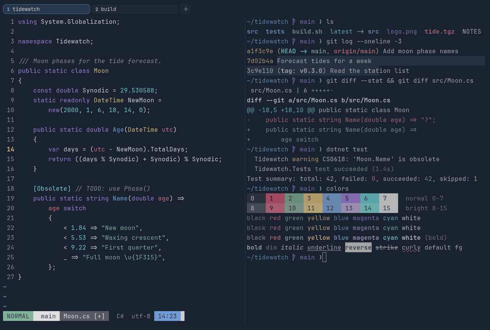

# Nightfox

Dark. Upstream: Nightfox.



## What it looks like

Light grey text on deep navy (#192330). The accents are soft: rose red, sage green, sand yellow, blue, violet and
cyan. Calm and cool.

## Where it comes from

From [nightfox.nvim](https://github.com/EdenEast/nightfox.nvim) by EdenEast. MIT license.

## Use it

```toml
color_scheme = "Nightfox"
```

Its accent, which colors the active tab, focus marks and palette highlights, is `#719cd6` (blue). `[colors] accent` in
your config overrides it.

## Accessibility

Measured from the pixels of the screenshot above (focused editor) and of the same scene with the editor in the
inactive pane (dimmed by the default `inactive_pane_hsb`): the statusline's text against its own block.

| Statusline block | Focused | Dimmed | Without the contrast default |
|---|---|---|---|
| NORMAL (black on green) | 4.73:1 | 3.69:1 | 4.73:1 / 3.69:1 |
| main (black on white) | 8.5:1 | 6.32:1 | 8.5:1 / 6.32:1 |
| Moon.cs [+] (white on bright black) | 5.31:1 | 4.37:1 | 5.31:1 / 4.37:1 |
| C# utf-8 (bright black text) | 4.54:1 | 3.11:1 | 2.24:1 / 1.71:1 |
| 14:23 (black on blue) | 4.52:1 | 3.64:1 | 3.96:1 / 3.31:1 |

Lowest: 4.52:1 focused (target 4.5:1, WCAG AA) and 3.11:1 dimmed (target 3:1). Body text: 10:1.

The built-in contrast default (`minimum_contrast = 4.5`) does the work here. As published, these are below 4.5:1, and
erikterm draws them lighter or darker, keeping their hue, until they reach it: text in black (1.4:1), red (3.6:1),
bright black (2.2:1); black text on blue (3.9:1). The palette is as published, not adapted. With `minimum_contrast =
1` in your config you get the published colors as they are; the notes below describe those.

Bright black is a dark grey, so autosuggestions and comments are faint.

## See also

- [Carbonfox](carbonfox.md)
- [Nord](nord.md)
- [Tokyo Night](tokyo-night.md)
- [All color schemes](README.md)
