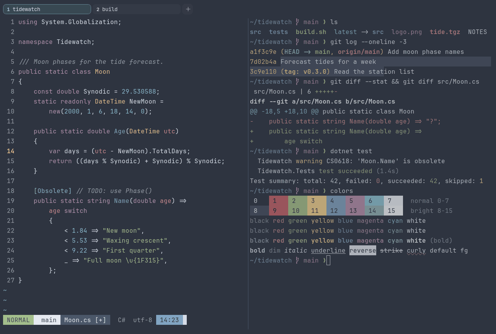

# Nord

Dark. Upstream: Nord.



## What it looks like

Light grey text on an arctic blue-grey background (#2e3440). The accents are muted: dusty red, sage green, sand
yellow, steel blue, mauve and frost cyan. Calm and low in contrast on purpose.

## Where it comes from

From [Nord](https://github.com/nordtheme/alacritty) by Sven Greb (Arctic Ice Studio). MIT license.

## Use it

```toml
color_scheme = "Nord"
```

Its accent, which colors the active tab, focus marks and palette highlights, is `#88c0d0` (frost cyan). `[colors]
accent` in your config overrides it.

## Accessibility

Measured from the pixels of the screenshot above (focused editor) and of the same scene with the editor in the
inactive pane (dimmed by the default `inactive_pane_hsb`): the statusline's text against its own block.

| Statusline block | Focused | Dimmed | Without the contrast default |
|---|---|---|---|
| NORMAL (black on green) | 5.01:1 | 3.94:1 | 5.01:1 / 3.94:1 |
| main (black on white) | 8.39:1 | 6.37:1 | 8.39:1 / 6.37:1 |
| Moon.cs [+] (white on bright black) | 6.06:1 | 4.92:1 | 6.06:1 / 4.92:1 |
| C# utf-8 (bright black text) | 4.53:1 | 3.06:1 | 1.69:1 / 1.32:1 |
| 14:23 (black on blue) | 4.5:1 | 3.57:1 | 3.74:1 / 3.09:1 |

Lowest: 4.5:1 focused (target 4.5:1, WCAG AA) and 3.06:1 dimmed (target 3:1). Body text: 9.2:1.

The built-in contrast default (`minimum_contrast = 4.5`) does the work here. As published, these are below 4.5:1, and
erikterm draws them lighter or darker, keeping their hue, until they reach it: text in black (1.2:1), red (3.1:1),
magenta (4.4:1), bright black (1.7:1), bright red (3.1:1), bright magenta (4.4:1); black text on blue (3.7:1). The
palette is as published, not adapted. With `minimum_contrast = 1` in your config you get the published colors as they
are; the notes below describe those.

Nord is low in contrast by design. Bright black (autosuggestions, comments) is close to the background.

## See also

- [Everforest Dark](everforest-dark.md)
- [Nightfox](nightfox.md)
- [One Half Dark](one-half-dark.md)
- [All color schemes](README.md)
