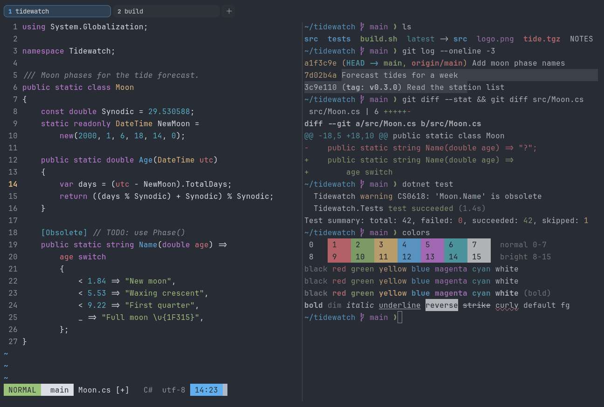

# One Half Dark

Dark. Upstream: One Half.



## What it looks like

Light grey text on blue-grey (#282c34). The accents are Atom One Dark's: soft red, green, gold, blue, violet and teal.
Familiar and balanced.

## Where it comes from

From [onehalf](https://github.com/sonph/onehalf) by Son A. Pham, a terminal version of Atom's One themes. MIT license.

## Use it

```toml
color_scheme = "One Half Dark"
```

Its accent, which colors the active tab, focus marks and palette highlights, is `#61afef` (blue). `[colors] accent` in
your config overrides it.

## Accessibility

Measured from the pixels of the screenshot above (focused editor) and of the same scene with the editor in the
inactive pane (dimmed by the default `inactive_pane_hsb`): the statusline's text against its own block.

| Statusline block | Focused | Dimmed | Without the contrast default |
|---|---|---|---|
| NORMAL (black on green) | 7.04:1 | 5.12:1 | 7.04:1 / 5.12:1 |
| main (black on white) | 10.62:1 | 7.49:1 | 10.62:1 / 7.49:1 |
| Moon.cs [+] (white on bright black) | 10.48:1 | 6.66:1 | 10.48:1 / 6.66:1 |
| C# utf-8 (bright black text) | 4.54:1 | 3.07:1 | 1.01:1 / 1.12:1 |
| 14:23 (black on blue) | 5.94:1 | 4.62:1 | 5.94:1 / 4.62:1 |

Lowest: 4.54:1 focused (target 4.5:1, WCAG AA) and 3.07:1 dimmed (target 3:1). Body text: 10:1.

The built-in contrast default (`minimum_contrast = 4.5`) does the work here. As published, these are below 4.5:1, and
erikterm draws them lighter or darker, keeping their hue, until they reach it: text in black (1:1), red (4.4:1),
bright black (1:1), bright red (4.4:1). The palette is as published, not adapted. With `minimum_contrast = 1` in your
config you get the published colors as they are; the notes below describe those.

One Half has no separate brights: they repeat the normals, and bright black is the background color, so
autosuggestions in that color don't show.

## See also

- [One Half Light](one-half-light.md)
- [erik](erik.md)
- [GitHub Dark](github-dark.md)
- [All color schemes](README.md)
