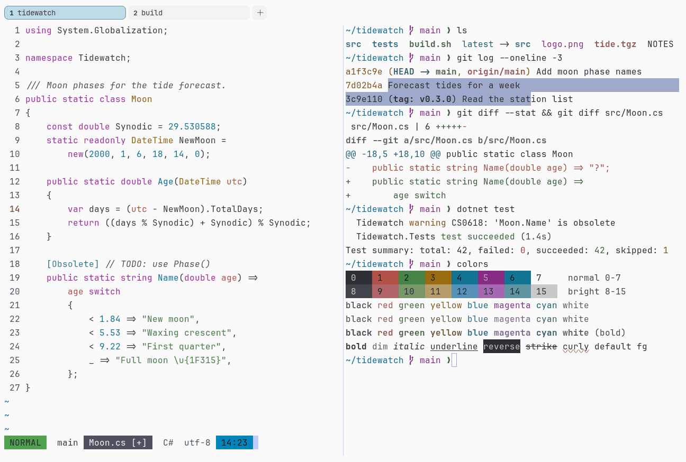

# One Half Light

Light. Upstream: One Half.



## What it looks like

Dark grey text on near-white (#fafafa). The accents are Atom One Light's: red, green, amber, blue, magenta and teal.
Clean and familiar.

## Where it comes from

From [onehalf](https://github.com/sonph/onehalf) by Son A. Pham, a terminal version of Atom's One themes. MIT license.

## Use it

```toml
color_scheme = "One Half Light"
```

Its accent, which colors the active tab, focus marks and palette highlights, is `#0184bc` (blue). `[colors] accent` in
your config overrides it.

## Accessibility

Measured from the pixels of the screenshot above (focused editor) and of the same scene with the editor in the
inactive pane (dimmed by the default `inactive_pane_hsb`): the statusline's text against its own block.

| Statusline block | Focused | Dimmed | Without the contrast default |
|---|---|---|---|
| NORMAL (black on green) | 4.58:1 | 3.47:1 | 3.59:1 / 2.89:1 |
| main (black on white) | 11.03:1 | 12.96:1 | 11.03:1 / 12.96:1 |
| Moon.cs [+] (white on bright black) | 7.45:1 | 5.91:1 | 7.45:1 / 5.91:1 |
| C# utf-8 (bright black text) | 7.57:1 | 9.63:1 | 7.57:1 / 9.63:1 |
| 14:23 (black on blue) | 4.52:1 | 3.41:1 | 2.73:1 / 2.38:1 |

Lowest: 4.52:1 focused (target 4.5:1, WCAG AA) and 3.41:1 dimmed (target 3:1). Body text: 11:1.

The built-in contrast default (`minimum_contrast = 4.5`) does the work here. As published, these are below 4.5:1, and
erikterm draws them lighter or darker, keeping their hue, until they reach it: text in red (3.5:1), green (3.1:1),
yellow (3.1:1), blue (4:1), cyan (3.3:1), white (1:1), bright red (3.1:1), bright green (1.9:1), bright yellow
(1.7:1), bright blue (2.3:1), bright magenta (2.8:1), bright cyan (2.3:1), bright white (1:1); black text on green
(3.5:1), blue (2.7:1). The palette is as published, not adapted. With `minimum_contrast = 1` in your config you get
the published colors as they are; the notes below describe those.

Upstream white is the background color, and the brights are One Dark's colors, which are pale on a light background.

## See also

- [One Half Dark](one-half-dark.md)
- [GitHub Light](github-light.md)
- [Ayu Light](ayu-light.md)
- [All color schemes](README.md)
