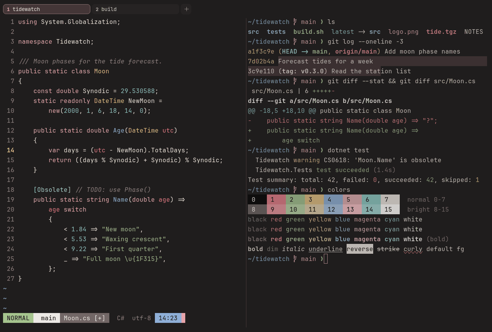

# Onyx & Rose

Dark. Original for erikterm.



## What it looks like

Cream text on warm near-black (#1f1d1d). The accents are soft: coral red, sage green, sand, powder blue, rose and
seafoam. The dark side of Cream & Rose.

## Where it comes from

Made for erikterm, inspired by black keycap sets with rose legends. Seed colors were chosen by eye, then adjusted to
the contrast floors.

## Use it

```toml
color_scheme = "Onyx & Rose"
```

Its accent, which colors the active tab, focus marks and palette highlights, is `#e8a5ab` (soft rose). `[colors]
accent` in your config overrides it.

## Accessibility

Measured from the pixels of the screenshot above (focused editor) and of the same scene with the editor in the
inactive pane (dimmed by the default `inactive_pane_hsb`): the statusline's text against its own block.

| Statusline block | Focused | Dimmed | Without the contrast default |
|---|---|---|---|
| NORMAL (black on green) | 9.91:1 | 6.6:1 | 9.91:1 / 6.6:1 |
| main (black on white) | 15.79:1 | 10.2:1 | 15.79:1 / 10.2:1 |
| Moon.cs [+] (white on bright black) | 4.61:1 | 3.95:1 | 4.61:1 / 3.95:1 |
| C# utf-8 (bright black text) | 4.51:1 | 3.14:1 | 3.01:1 / 2.22:1 |
| 14:23 (black on blue) | 8.46:1 | 5.92:1 | 8.46:1 / 5.92:1 |

Lowest: 4.51:1 focused (target 4.5:1, WCAG AA) and 3.14:1 dimmed (target 3:1). Body text: 13:1.

The palette itself is made for these targets: black text on every color and white text on bright black reach 4.6:1 or
more without any help, and the other colors read at 3:1 or better as text. Bright black is 3:1 as text: it is kept
dark enough to carry white text as a block, and the built-in contrast default (`minimum_contrast = 4.5`) lifts it to
4.5:1 where it is text (the C# utf-8 row), like any color used as text below 4.5:1.

## See also

- [Cream & Rose](cream-and-rose.md)
- [Graphite & Blush](graphite-and-blush.md)
- [Night Blossom](night-blossom.md)
- [All color schemes](README.md)
