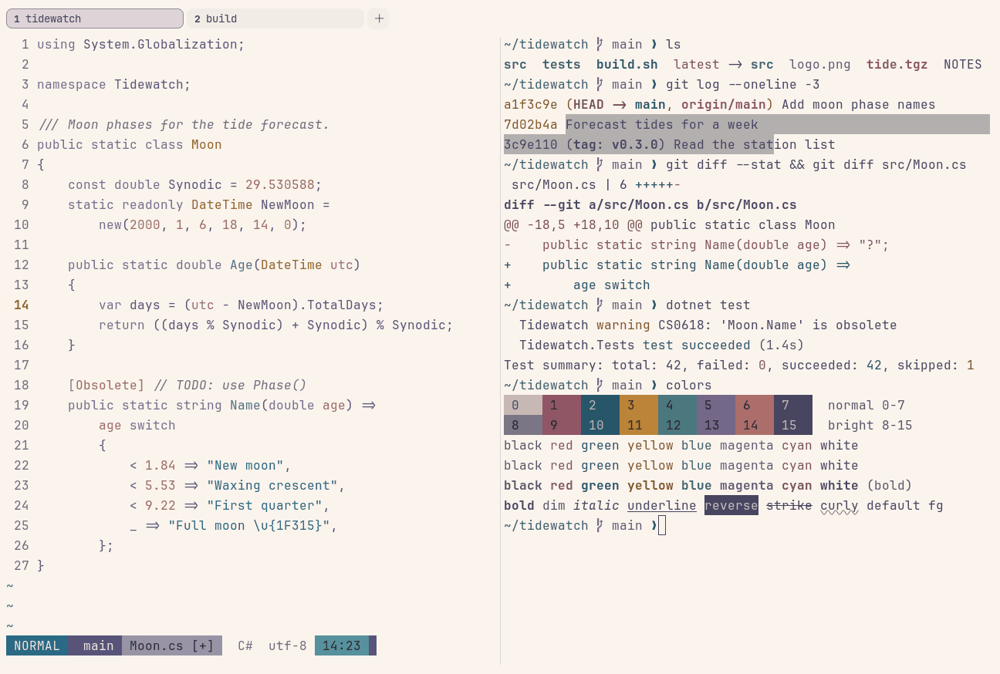

# Rosé Pine Dawn

Light. Upstream: Rosé Pine.



## What it looks like

Muted purple text on warm off-white (#faf4ed). The accents are dusty: rose red, pine, gold, foam teal, iris and rose.
Soft and warm rather than crisp.

## Where it comes from

From [Rosé Pine](https://github.com/rose-pine/ghostty) by the Rosé Pine team. MIT license.

## Use it

```toml
color_scheme = "Rosé Pine Dawn"
```

Its accent, which colors the active tab, focus marks and palette highlights, is `#907aa9` (iris). `[colors] accent` in
your config overrides it.

## Accessibility

Measured from the pixels of the screenshot above (focused editor) and of the same scene with the editor in the
inactive pane (dimmed by the default `inactive_pane_hsb`): the statusline's text against its own block.

| Statusline block | Focused | Dimmed | Without the contrast default |
|---|---|---|---|
| NORMAL (black on green) | 5.09:1 | 4.22:1 | 5.09:1 / 4.22:1 |
| main (black on white) | 6.07:1 | 4.81:1 | 6.07:1 / 4.81:1 |
| Moon.cs [+] (white on bright black) | 4.58:1 | 3.48:1 | 2.48:1 / 2.13:1 |
| C# utf-8 (bright black text) | 4.6:1 | 6.37:1 | 2.76:1 / 4.05:1 |
| 14:23 (black on blue) | 4.52:1 | 3.44:1 | 2.86:1 / 2.61:1 |

Lowest: 4.52:1 focused (target 4.5:1, WCAG AA) and 3.44:1 dimmed (target 3:1). Body text: 6.7:1.

The built-in contrast default (`minimum_contrast = 4.5`) does the work here. As published, these are below 4.5:1, and
erikterm draws them lighter or darker, keeping their hue, until they reach it: text in black (1.1:1), red (3.8:1),
yellow (2.1:1), blue (3.1:1), magenta (3.5:1), cyan (2.6:1), bright black (2.7:1), bright red (3.8:1), bright yellow
(2.1:1), bright blue (3.1:1), bright magenta (3.5:1), bright cyan (2.6:1); black text on blue (2.9:1); white text on
bright black (2.4:1); bright white text on bright black (2.4:1). The palette is as published, not adapted. With
`minimum_contrast = 1` in your config you get the published colors as they are; the notes below describe those.

Upstream yellow and cyan are pale on this background.

## See also

- [Rosé Pine](rose-pine.md)
- [Rosé Pine Moon](rose-pine-moon.md)
- [Catppuccin Latte](catppuccin-latte.md)
- [All color schemes](README.md)
