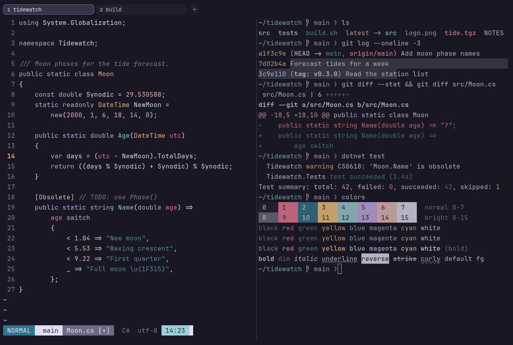

# Rosé Pine

Dark. Upstream: Rosé Pine.



## What it looks like

Lavender-white text on a deep purple-black background (#191724). The accents are muted: love (rose red), pine (deep
teal), gold, foam (pale cyan), iris (violet) and rose. Quiet and elegant.

## Where it comes from

From [Rosé Pine](https://github.com/rose-pine/ghostty) by the Rosé Pine team. MIT license.

## Use it

```toml
color_scheme = "Rosé Pine"
```

Its accent, which colors the active tab, focus marks and palette highlights, is `#c4a7e7` (iris). `[colors] accent` in
your config overrides it.

## Accessibility

Measured from the pixels of the screenshot above (focused editor) and of the same scene with the editor in the
inactive pane (dimmed by the default `inactive_pane_hsb`): the statusline's text against its own block.

| Statusline block | Focused | Dimmed | Without the contrast default |
|---|---|---|---|
| NORMAL (black on green) | 4.5:1 | 3.81:1 | 2.95:1 / 2.36:1 |
| main (black on white) | 11.65:1 | 8.02:1 | 11.65:1 / 8.02:1 |
| Moon.cs [+] (white on bright black) | 4.5:1 | 3.84:1 | 3.91:1 / 3.39:1 |
| C# utf-8 (bright black text) | 4.51:1 | 3.21:1 | 3.42:1 / 2.53:1 |
| 14:23 (black on blue) | 8.91:1 | 6.22:1 | 8.91:1 / 6.22:1 |

Lowest: 4.5:1 focused (target 4.5:1, WCAG AA) and 3.21:1 dimmed (target 3:1). Body text: 13:1.

The built-in contrast default (`minimum_contrast = 4.5`) does the work here. As published, these are below 4.5:1, and
erikterm draws them lighter or darker, keeping their hue, until they reach it: text in black (1.2:1), green (3.4:1),
bright black (3.4:1), bright green (3.4:1); black text on green (2.9:1); white text on bright black (3.9:1); bright
white text on bright black (3.9:1). The palette is as published, not adapted. With `minimum_contrast = 1` in your
config you get the published colors as they are; the notes below describe those.

Rosé Pine maps ANSI green to pine, a deep teal, so green text is darker than the other colors.

## See also

- [Rosé Pine Moon](rose-pine-moon.md)
- [Rosé Pine Dawn](rose-pine-dawn.md)
- [Kanagawa Wave](kanagawa-wave.md)
- [All color schemes](README.md)
