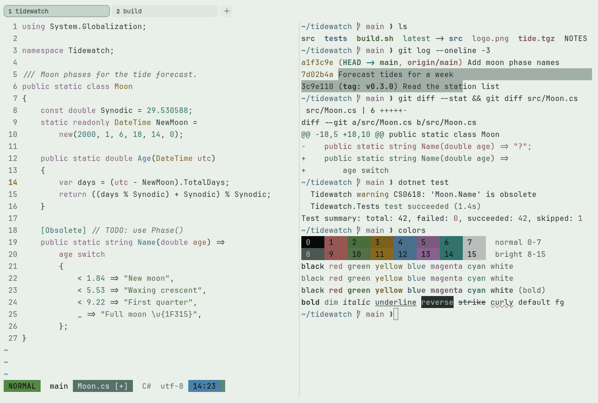

# Sage Garden

Light. Original for erikterm.



## What it looks like

Deep green-grey text on pale sage paper (#e9efe9). The accents are botanical: terracotta, leaf green, ochre, blue,
mauve and teal. Fresh and calm.

## Where it comes from

Made for erikterm, inspired by sage-green keycap sets with cream legends. Seed colors were chosen by eye, then
adjusted to the contrast floors.

## Use it

```toml
color_scheme = "Sage Garden"
```

Its accent, which colors the active tab, focus marks and palette highlights, is `#5f8a7f` (sage). `[colors] accent` in
your config overrides it.

## Accessibility

Measured from the pixels of the screenshot above (focused editor) and of the same scene with the editor in the
inactive pane (dimmed by the default `inactive_pane_hsb`): the statusline's text against its own block.

| Statusline block | Focused | Dimmed | Without the contrast default |
|---|---|---|---|
| NORMAL (black on green) | 4.75:1 | 3.39:1 | 4.75:1 / 3.39:1 |
| main (black on white) | 17.12:1 | 10.82:1 | 17.12:1 / 10.82:1 |
| Moon.cs [+] (white on bright black) | 4.61:1 | 3.95:1 | 4.61:1 / 3.95:1 |
| C# utf-8 (bright black text) | 4.68:1 | 6.41:1 | 4.68:1 / 6.41:1 |
| 14:23 (black on blue) | 4.74:1 | 3.51:1 | 4.74:1 / 3.51:1 |

Lowest: 4.61:1 focused (target 4.5:1, WCAG AA) and 3.39:1 dimmed (target 3:1). Body text: 10:1.

The palette itself is made for these targets: black text on every color and white text on bright black reach 4.6:1 or
more without any help, and bright black text reaches it too. Every color reads at 3:1 or better as text; the built-in
contrast default (`minimum_contrast = 4.5`) lifts the ones below 4.5:1 to 4.5:1.

## See also

- [Everforest Light](everforest-light.md)
- [Cream & Rose](cream-and-rose.md)
- [Kanagawa Lotus](kanagawa-lotus.md)
- [All color schemes](README.md)
