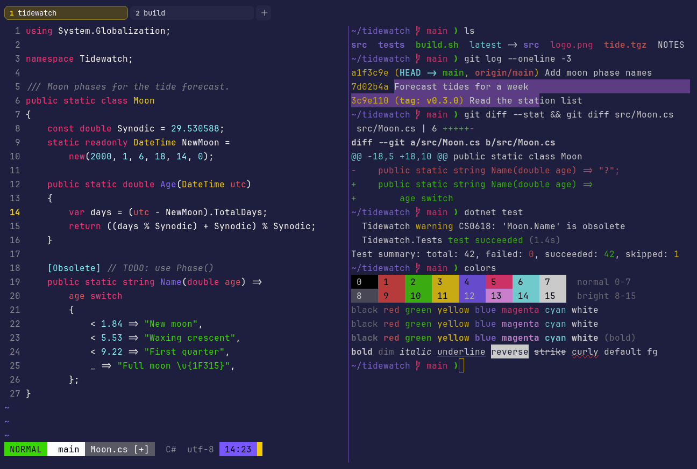

# Shades of Purple

Dark. Upstream: Shades of Purple.



## What it looks like

White text on saturated indigo (#1e1e3f). The accents are bold: red, lime green, golden yellow, violet, hot pink and
aqua. Very purple and very bright.

## Where it comes from

From [Shades of Purple](https://github.com/ahmadawais/shades-of-purple-vscode) by Ahmad Awais. MIT license, with an
added line asking that anything built with it is MIT licensed too, which erikterm is.

## Use it

```toml
color_scheme = "Shades of Purple"
```

Its accent, which colors the active tab, focus marks and palette highlights, is `#fad000` (yellow). `[colors] accent`
in your config overrides it.

## Accessibility

Measured from the pixels of the screenshot above (focused editor) and of the same scene with the editor in the
inactive pane (dimmed by the default `inactive_pane_hsb`): the statusline's text against its own block.

| Statusline block | Focused | Dimmed | Without the contrast default |
|---|---|---|---|
| NORMAL (black on green) | 11.11:1 | 7.25:1 | 11.11:1 / 7.25:1 |
| main (black on white) | 21.0:1 | 13.08:1 | 21.0:1 / 13.08:1 |
| Moon.cs [+] (white on bright black) | 6.65:1 | 5.49:1 | 6.65:1 / 5.49:1 |
| C# utf-8 (bright black text) | 4.53:1 | 3.1:1 | 2.41:1 / 1.81:1 |
| 14:23 (black on blue) | 4.59:1 | 3.72:1 | 4.59:1 / 3.72:1 |

Lowest: 4.53:1 focused (target 4.5:1, WCAG AA) and 3.1:1 dimmed (target 3:1). Body text: 16:1.

The built-in contrast default (`minimum_contrast = 4.5`) does the work here. As published, these are below 4.5:1, and
erikterm draws them lighter or darker, keeping their hue, until they reach it: text in black (1.3:1), red (3.8:1),
blue (3.5:1), magenta (4.5:1), bright black (2.4:1), bright red (3.8:1), bright blue (2.9:1). The palette is as
published, not adapted. With `minimum_contrast = 1` in your config you get the published colors as they are; the notes
below describe those.

ANSI blue is a violet close to the background in brightness, so blue text is the weakest color.

## See also

- [Dracula](dracula.md)
- [Cyberpunk](cyberpunk.md)
- [SynthWave '84](synthwave-84.md)
- [All color schemes](README.md)
