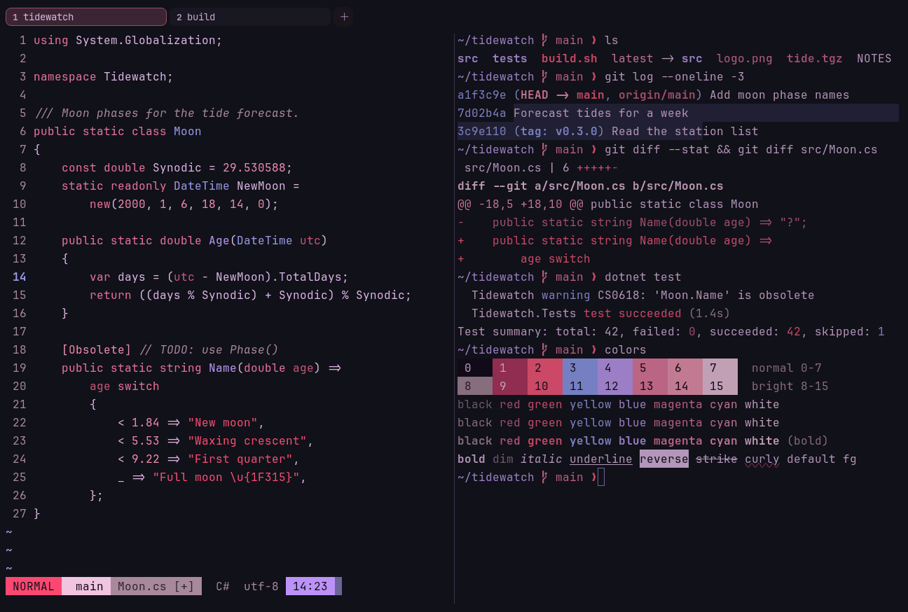

# Shado

Dark. Upstream: Shado.



## What it looks like

Pink-lilac text on near-black (#111119). The palette is almost all pink and purple: crimson, hot pink, periwinkle,
violet and rose. A dark cherry-blossom look.

## Where it comes from

From [shadotheme](https://github.com/Shadorain/shadotheme) by Shadorain, a purple-and-pink dark Neovim theme. BSD
3-Clause license.

## Use it

```toml
color_scheme = "Shado"
```

Its accent, which colors the active tab, focus marks and palette highlights, is `#e9729d` (pink). `[colors] accent` in
your config overrides it.

## Accessibility

Measured from the pixels of the screenshot above (focused editor) and of the same scene with the editor in the
inactive pane (dimmed by the default `inactive_pane_hsb`): the statusline's text against its own block.

| Statusline block | Focused | Dimmed | Without the contrast default |
|---|---|---|---|
| NORMAL (black on green) | 5.94:1 | 4.39:1 | 5.94:1 / 4.39:1 |
| main (black on white) | 12.66:1 | 8.36:1 | 12.66:1 / 8.36:1 |
| Moon.cs [+] (white on bright black) | 4.56:1 | 3.48:1 | 2.04:1 / 1.93:1 |
| C# utf-8 (bright black text) | 6.01:1 | 4.14:1 | 6.01:1 / 4.14:1 |
| 14:23 (black on blue) | 7.98:1 | 5.79:1 | 7.98:1 / 5.79:1 |

Lowest: 4.56:1 focused (target 4.5:1, WCAG AA) and 3.48:1 dimmed (target 3:1). Body text: 11:1.

The built-in contrast default (`minimum_contrast = 4.5`) does the work here. As published, these are below 4.5:1, and
erikterm draws them lighter or darker, keeping their hue, until they reach it: text in black (1:1), red (3.1:1),
bright red (3.1:1); white text on bright black (2:1); bright white text on bright black (2:1). The palette is as
published, not adapted. With `minimum_contrast = 1` in your config you get the published colors as they are; the notes
below describe those.

The ANSI colors don't follow their usual roles: green is hot pink and yellow is periwinkle, so a failed and a passed
test can look alike. Night Blossom has a similar look with conventional roles.

## See also

- [Night Blossom](night-blossom.md)
- [Cherry Blossom](cherry-blossom.md)
- [Rosé Pine](rose-pine.md)
- [All color schemes](README.md)
