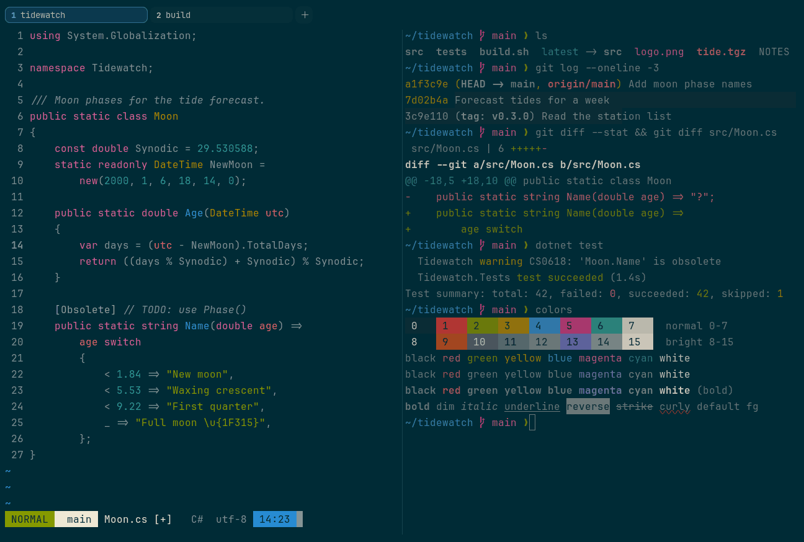

# Solarized Dark

Dark. Upstream: Solarized.



## What it looks like

Grey-teal text on deep blue-green (#002b36). The accents are Solarized's eight: red, green, yellow, blue, magenta,
cyan, plus orange and violet in the brights. The brights are mostly greys by design. Precise and low-glare.

## Where it comes from

From [Solarized](https://github.com/altercation/solarized) by Ethan Schoonover. MIT license.

## Use it

```toml
color_scheme = "Solarized Dark"
```

Its accent, which colors the active tab, focus marks and palette highlights, is `#268bd2` (blue). `[colors] accent` in
your config overrides it.

## Accessibility

Measured from the pixels of the screenshot above (focused editor) and of the same scene with the editor in the
inactive pane (dimmed by the default `inactive_pane_hsb`): the statusline's text against its own block.

| Statusline block | Focused | Dimmed | Without the contrast default |
|---|---|---|---|
| NORMAL (black on green) | 4.56:1 | 3.38:1 | 4.11:1 / 3.15:1 |
| main (black on white) | 10.76:1 | 7.68:1 | 10.76:1 / 7.68:1 |
| Moon.cs [+] (white on bright black) | 12.25:1 | 7.73:1 | 12.25:1 / 7.73:1 |
| C# utf-8 (bright black text) | 4.52:1 | 3.08:1 | 1.01:1 / 1.1:1 |
| 14:23 (black on blue) | 4.51:1 | 3.55:1 | 3.54:1 / 2.99:1 |

Lowest: 4.51:1 focused (target 4.5:1, WCAG AA) and 3.08:1 dimmed (target 3:1). Body text: 4.7:1.

The built-in contrast default (`minimum_contrast = 4.5`) does the work here. As published, these are below 4.5:1, and
erikterm draws them lighter or darker, keeping their hue, until they reach it: text in black (1.2:1), red (3.2:1),
blue (4.1:1), magenta (3.3:1), bright black (1:1), bright red (3.3:1), bright green (2.8:1), bright yellow (3.4:1),
bright magenta (3.4:1); black text on green (4.1:1), blue (3.5:1). The palette is as published, not adapted. With
`minimum_contrast = 1` in your config you get the published colors as they are; the notes below describe those.

Solarized keeps body text at a moderate contrast on purpose. Bright black is the background color, and several brights
are greys, so programs that use bright colors for emphasis look subdued. The selection is subtle.

## See also

- [Solarized Light](solarized-light.md)
- [Gruvbox Dark](gruvbox-dark.md)
- [Nord](nord.md)
- [All color schemes](README.md)
