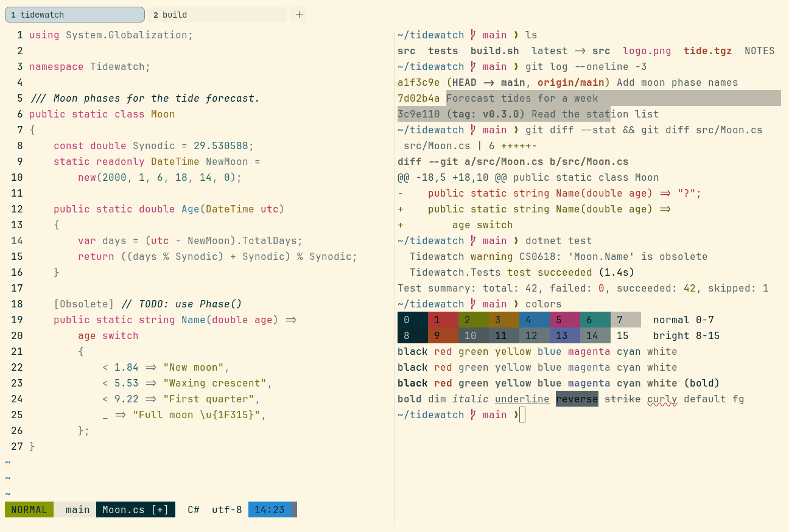

# Solarized Light

Light. Upstream: Solarized.



## What it looks like

Grey-blue text on warm cream paper (#fdf6e3). The same eight accents as Solarized Dark. Soft and low-glare.

## Where it comes from

From [Solarized](https://github.com/altercation/solarized) by Ethan Schoonover. MIT license.

## Use it

```toml
color_scheme = "Solarized Light"
```

Its accent, which colors the active tab, focus marks and palette highlights, is `#268bd2` (blue). `[colors] accent` in
your config overrides it.

## Accessibility

Measured from the pixels of the screenshot above (focused editor) and of the same scene with the editor in the
inactive pane (dimmed by the default `inactive_pane_hsb`): the statusline's text against its own block.

| Statusline block | Focused | Dimmed | Without the contrast default |
|---|---|---|---|
| NORMAL (black on green) | 4.56:1 | 3.38:1 | 4.11:1 / 3.15:1 |
| main (black on white) | 10.76:1 | 7.68:1 | 10.76:1 / 7.68:1 |
| Moon.cs [+] (white on bright black) | 12.25:1 | 8.44:1 | 12.25:1 / 8.44:1 |
| C# utf-8 (bright black text) | 14.08:1 | 15.38:1 | 14.08:1 / 15.38:1 |
| 14:23 (black on blue) | 4.51:1 | 3.55:1 | 3.54:1 / 2.99:1 |

Lowest: 4.51:1 focused (target 4.5:1, WCAG AA) and 3.38:1 dimmed (target 3:1). Body text: 4.1:1 as published, drawn at
4.5:1.

The built-in contrast default (`minimum_contrast = 4.5`) does the work here. As published, these are below 4.5:1, and
erikterm draws them lighter or darker, keeping their hue, until they reach it: body text (4.1:1); text in red (4.3:1),
green (3:1), yellow (3:1), blue (3.4:1), magenta (4.2:1), cyan (2.9:1), white (1.1:1), bright red (4.3:1), bright
yellow (4.1:1), bright blue (2.9:1), bright magenta (4.1:1), bright cyan (2.5:1), bright white (1:1); black text on
green (4.1:1), blue (3.5:1). The palette is as published, not adapted. With `minimum_contrast = 1` in your config you
get the published colors as they are; the notes below describe those.

Solarized keeps body text soft on purpose. White and bright white are the background color, and green, yellow and cyan
are light on cream.

## See also

- [Solarized Dark](solarized-dark.md)
- [Gruvbox Light](gruvbox-light.md)
- [Everforest Light](everforest-light.md)
- [All color schemes](README.md)
