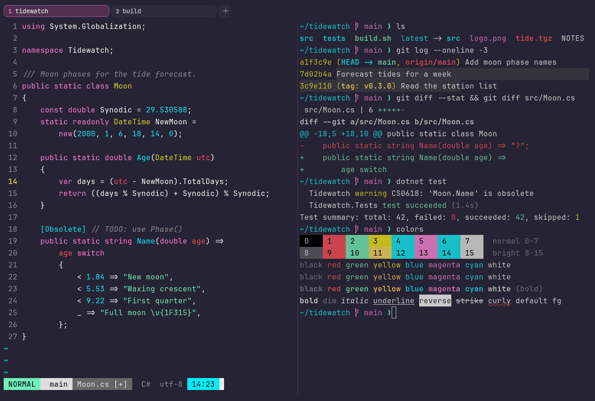

# SynthWave '84

Dark. Upstream: SynthWave.



## What it looks like

White text on deep purple (#262335). The accents are 80s neon: hot red, mint, lemon yellow, electric cyan and pink.
Loud and retro.

## Where it comes from

From [SynthWave '84](https://github.com/robb0wen/synthwave-vscode) by Robb Owen. MIT license. The upstream theme does
not define black, white or the background for the terminal, so VS Code's defaults fill those.

## Use it

```toml
color_scheme = "SynthWave '84"
```

Its accent, which colors the active tab, focus marks and palette highlights, is `#ff7edb` (pink). `[colors] accent` in
your config overrides it.

## Accessibility

Measured from the pixels of the screenshot above (focused editor) and of the same scene with the editor in the
inactive pane (dimmed by the default `inactive_pane_hsb`): the statusline's text against its own block.

| Statusline block | Focused | Dimmed | Without the contrast default |
|---|---|---|---|
| NORMAL (black on green) | 14.99:1 | 9.63:1 | 14.99:1 / 9.63:1 |
| main (black on white) | 16.67:1 | 10.47:1 | 16.67:1 / 10.47:1 |
| Moon.cs [+] (white on bright black) | 4.56:1 | 3.9:1 | 4.56:1 / 3.9:1 |
| C# utf-8 (bright black text) | 4.54:1 | 3.09:1 | 2.66:1 / 1.96:1 |
| 14:23 (black on blue) | 14.49:1 | 9.31:1 | 14.49:1 / 9.31:1 |

Lowest: 4.54:1 focused (target 4.5:1, WCAG AA) and 3.09:1 dimmed (target 3:1). Body text: 15:1.

The built-in contrast default (`minimum_contrast = 4.5`) does the work here. As published, these are below 4.5:1, and
erikterm draws them lighter or darker, keeping their hue, until they reach it: text in black (1.4:1), red (4.5:1),
bright black (2.7:1), bright red (4.5:1). The palette is as published, not adapted. With `minimum_contrast = 1` in
your config you get the published colors as they are; the notes below describe those.

Blue and cyan are the same cyan upstream, so programs that tell them apart show them alike.

## See also

- [LaserWave](laserwave.md)
- [Cyberpunk](cyberpunk.md)
- [Neon Grid](neon-grid.md)
- [All color schemes](README.md)
