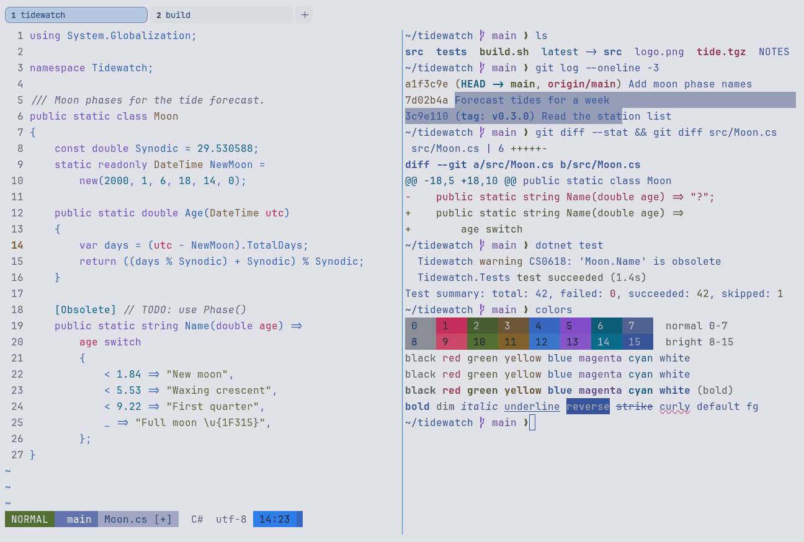

# Tokyo Night Day

Light. Upstream: Tokyo Night.



## What it looks like

Blue text on cool light grey (#e1e2e7). The accents are pink-red, green, brown, blue, violet and teal. Plain text is
blue, not black, which gives it a distinct look.

## Where it comes from

From [tokyonight.nvim](https://github.com/folke/tokyonight.nvim) by Folke Lemaitre. Apache License 2.0; the
attribution ships in erikterm's third-party notices.

## Use it

```toml
color_scheme = "Tokyo Night Day"
```

Its accent, which colors the active tab, focus marks and palette highlights, is `#2e7de9` (blue). `[colors] accent` in
your config overrides it.

## Accessibility

Measured from the pixels of the screenshot above (focused editor) and of the same scene with the editor in the
inactive pane (dimmed by the default `inactive_pane_hsb`): the statusline's text against its own block.

| Statusline block | Focused | Dimmed | Without the contrast default |
|---|---|---|---|
| NORMAL (black on green) | 4.51:1 | 3.86:1 | 2.55:1 / 2.27:1 |
| main (black on white) | 4.51:1 | 3.73:1 | 2.26:1 / 1.94:1 |
| Moon.cs [+] (white on bright black) | 4.58:1 | 3.59:1 | 1.96:1 / 1.76:1 |
| C# utf-8 (bright black text) | 4.58:1 | 6.1:1 | 1.87:1 / 2.77:1 |
| 14:23 (black on blue) | 4.54:1 | 3.63:1 | 1.96:1 / 1.65:1 |

Lowest: 4.51:1 focused (target 4.5:1, WCAG AA) and 3.59:1 dimmed (target 3:1). Body text: 4.5:1.

The built-in contrast default (`minimum_contrast = 4.5`) does the work here. As published, these are below 4.5:1, and
erikterm draws them lighter or darker, keeping their hue, until they reach it: text in black (1.6:1), red (3:1), green
(4:1), yellow (3.7:1), blue (3.1:1), magenta (3.3:1), cyan (4.3:1), white (3.6:1), bright black (1.8:1), bright red
(2.5:1), bright green (3.4:1), bright yellow (3.1:1), bright blue (2.6:1), bright magenta (2.8:1), bright cyan
(3.6:1); black text on green (2.6:1), white (2.3:1), blue (2:1); white text on bright black (1.9:1); bright white text
on bright black (2.4:1). The palette is as published, not adapted. With `minimum_contrast = 1` in your config you get
the published colors as they are; the notes below describe those.

Body text is a mid blue on a grey background, so it is softer than black on white. Black is a light grey here.

## See also

- [Tokyo Night](tokyo-night.md)
- [Tokyo Night Storm](tokyo-night-storm.md)
- [GitHub Light](github-light.md)
- [All color schemes](README.md)
