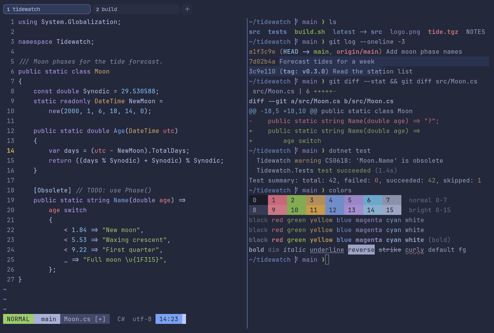

# Tokyo Night Storm

Dark. Upstream: Tokyo Night.



## What it looks like

Lavender-white text on a lighter storm blue (#24283b). The same accents as Tokyo Night: pink-red, green, amber, blue,
purple and sky blue. A little softer than the night variant.

## Where it comes from

From [tokyonight.nvim](https://github.com/folke/tokyonight.nvim) by Folke Lemaitre, a port of the Tokyo Night VS Code
theme by enkia. Apache License 2.0; the attribution ships in erikterm's third-party notices.

## Use it

```toml
color_scheme = "Tokyo Night Storm"
```

Its accent, which colors the active tab, focus marks and palette highlights, is `#7aa2f7` (blue). `[colors] accent` in
your config overrides it.

## Accessibility

Measured from the pixels of the screenshot above (focused editor) and of the same scene with the editor in the
inactive pane (dimmed by the default `inactive_pane_hsb`): the statusline's text against its own block.

| Statusline block | Focused | Dimmed | Without the contrast default |
|---|---|---|---|
| NORMAL (black on green) | 8.94:1 | 6.17:1 | 8.94:1 / 6.17:1 |
| main (black on white) | 7.74:1 | 5.55:1 | 7.74:1 / 5.55:1 |
| Moon.cs [+] (white on bright black) | 4.51:1 | 3.66:1 | 4.23:1 / 3.48:1 |
| C# utf-8 (bright black text) | 4.53:1 | 3.13:1 | 1.63:1 / 1.34:1 |
| 14:23 (black on blue) | 6.43:1 | 4.88:1 | 6.43:1 / 4.88:1 |

Lowest: 4.51:1 focused (target 4.5:1, WCAG AA) and 3.13:1 dimmed (target 3:1). Body text: 9:1.

The built-in contrast default (`minimum_contrast = 4.5`) does the work here. As published, these are below 4.5:1, and
erikterm draws them lighter or darker, keeping their hue, until they reach it: text in black (1.1:1), bright black
(1.6:1); white text on bright black (4.2:1). The palette is as published, not adapted. With `minimum_contrast = 1` in
your config you get the published colors as they are; the notes below describe those.

Bright black is a dark slate, so autosuggestions and comments are faint.

## See also

- [Tokyo Night](tokyo-night.md)
- [Tokyo Night Day](tokyo-night-day.md)
- [Catppuccin Macchiato](catppuccin-macchiato.md)
- [All color schemes](README.md)
