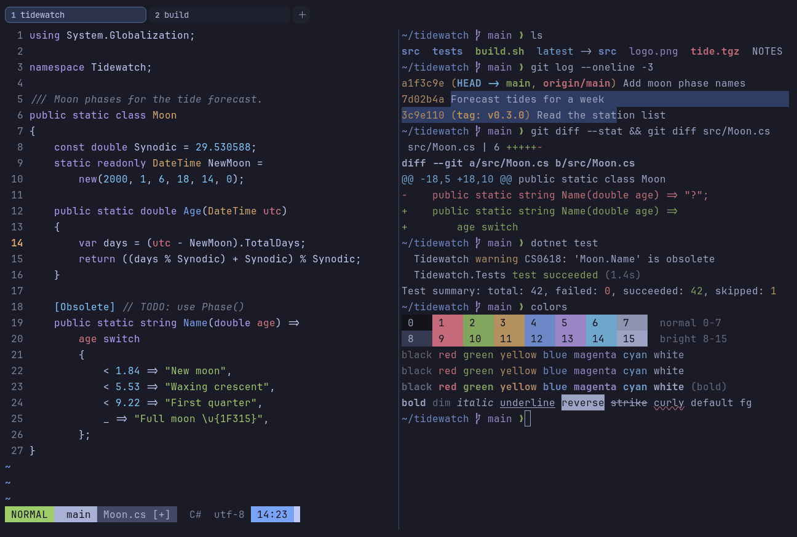

# Tokyo Night

Dark. Upstream: Tokyo Night.



## What it looks like

Lavender-white text on a deep navy-black background (#1a1b26). The accents are pink-red, green, amber, a clear blue,
purple and sky blue: the city-at-night look the name suggests.

## Where it comes from

From [tokyonight.nvim](https://github.com/folke/tokyonight.nvim) by Folke Lemaitre, a port of the Tokyo Night VS Code
theme by enkia. Apache License 2.0; the attribution ships in erikterm's third-party notices.

## Use it

```toml
color_scheme = "Tokyo Night"
```

Its accent, which colors the active tab, focus marks and palette highlights, is `#7aa2f7` (blue). `[colors] accent` in
your config overrides it.

## Accessibility

Measured from the pixels of the screenshot above (focused editor) and of the same scene with the editor in the
inactive pane (dimmed by the default `inactive_pane_hsb`): the statusline's text against its own block.

| Statusline block | Focused | Dimmed | Without the contrast default |
|---|---|---|---|
| NORMAL (black on green) | 9.95:1 | 6.71:1 | 9.95:1 / 6.71:1 |
| main (black on white) | 8.61:1 | 6.03:1 | 8.61:1 / 6.03:1 |
| Moon.cs [+] (white on bright black) | 4.51:1 | 3.66:1 | 4.23:1 / 3.48:1 |
| C# utf-8 (bright black text) | 4.5:1 | 3.19:1 | 1.91:1 / 1.57:1 |
| 14:23 (black on blue) | 7.17:1 | 5.32:1 | 7.17:1 / 5.32:1 |

Lowest: 4.5:1 focused (target 4.5:1, WCAG AA) and 3.19:1 dimmed (target 3:1). Body text: 11:1.

The built-in contrast default (`minimum_contrast = 4.5`) does the work here. As published, these are below 4.5:1, and
erikterm draws them lighter or darker, keeping their hue, until they reach it: text in black (1.1:1), bright black
(1.9:1); white text on bright black (4.2:1). The palette is as published, not adapted. With `minimum_contrast = 1` in
your config you get the published colors as they are; the notes below describe those.

Bright black is a dark slate blue, so autosuggestions and comments are faint.

## See also

- [Tokyo Night Storm](tokyo-night-storm.md)
- [Tokyo Night Day](tokyo-night-day.md)
- [Night Owl](night-owl.md)
- [All color schemes](README.md)
